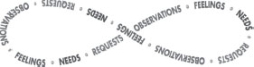

**The Four-Part Nonviolent Communication Process**

Clearly expressing  
how **I am  
** without blaming  
or criticizing | Empathically receiving  
how **you are**  
without hearing  
blame or criticism  
---|---  
  
**OBSERVATIONS**

1\. What I observe _(see, hear, remember, imagine, free from my evaluations)_ that does or does not contribute to my well-being: _“When I (see, hear) … ”_ | 1\. What you observe _(see, hear, remember, imagine, free from your evaluations)_ that does or does not contribute to your well-being: _“When you see/hear … ” (Sometimes unspoken when offering empathy)_  
---|---  
  
**FEELINGS**

2\. How I feel _(emotion or sensation rather than thought)_ in relation to what I observe: _“I feel … ”_ | 2\. How you feel _(emotion or sensation rather than thought)_ in relation to what you observe: _“You feel …”_  
---|---  
  
**NEEDS**

3\. What I need or value _(rather than a preference, or a specific action)_ that causes my feelings: _“ … because I need/value … ”_ | 3\. What you need or value _(rather than a preference, or a specific action)_ that causes your feelings: _“ … because you need/value …”_  
---|---  
  
Clearly requesting that which would enrich **my** life without demanding | Empathically receiving that which would enrich **your** life without hearing any demand  
---|---  
  
**REQUESTS**

4\. The concrete actions I would like taken: _“Would you be willing to … ?”_ | 4\. The concrete actions you would like taken: _“Would you like … ?” (Sometimes unspoken when offering empathy)_  
---|---  
  

© Marshall B. Rosenberg. For more information about Marshall B. Rosenberg or the Center for Nonviolent Communication, please visit [www.CNVC.org](http://www.CNVC.org).
