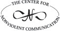

**About the Center for Nonviolent Communication**

The Center for Nonviolent Communication (CNVC) is an international nonprofit peacemaking organization whose vision is a world where everyone’s needs are met peacefully. CNVC is devoted to supporting the spread of Nonviolent Communication (NVC) around the world.

Founded in 1984 by Dr. Marshall B. Rosenberg, CNVC has been contributing to a vast social transformation in thinking, speaking and acting—showing people how to connect in ways that inspire compassionate results. NVC is now being taught around the globe in communities, schools, prisons, mediation centers, churches, businesses, professional conferences, and more. Hundreds of certified trainers and hundreds more supporters teach NVC to tens of thousands of people each year in more than 60 countries.

CNVC believes that NVC training is a crucial step to continue building a compassionate, peaceful society. Your tax-deductible donation will help CNVC continue to provide training in some of the most impoverished, violent corners of the world. It will also support the development and continuation of organized projects aimed at bringing NVC training to high-need geographic regions and populations.

To make a tax-deductible donation or to learn more about the valuable resources described below, visit the CNVC website at [www.CNVC.org](http://www.CNVC.org):

  * **Training and Certification** —Find local, national, and international training opportunities, access trainer certification information, connect to local NVC communities, trainers, and more.
  * **CNVC Bookstore** —Find mail or phone order information for a complete selection of NVC books, booklets, audio, and video materials at the CNVC website.
  * **CNVC Projects** —Participate in one of the several regional and theme-based projects that provide focus and leadership for teaching NVC in a particular application or geographic region.
  * **E-Groups and List Servs** —Join one of several moderated, topic-based NVC e-groups and list servs developed to support individual learning and the continued growth of NVC worldwide.

**For more information, please contact CNVC at:**

9301 Indian School Rd., NE, Suite 204, Albuquerque, NM 87112-2861

Ph: 505-244-4041 • US Only: 800-255-7696 • Fax: 505-247-0414

Email: [cnvc@CNVC.org](mailto:cnvc@CNVC.org) • Website: [www.CNVC.org](http://www.CNVC.org)
