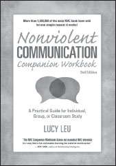

**Nonviolent Communication Companion Workbook,** 2nd Edition

_A Practical Guide for Individual, Group, or Classroom Study_

**by Lucy Leu**

Trade Paper 7x10, 240pp  
ISBN: 978-1-892005-29-8

Learning Nonviolent Communication has often been equated with learning a whole new language. The _NVC Companion Workbook_ helps you put these powerful, effective skills into practice with chapter-by-chapter study of Marshall Rosenberg’s cornerstone text, _NVC: A Language of Life_. Create a safe, supportive group learning or practice environment that nurtures the needs of each participant. Find a wealth of activities, exercises, and facilitator suggestions to refine and practice this powerful communication process.

**Nonviolent Communication has flourished for more than four decades across sixty countries selling more than 1,000,000 books for a simple reason: it works.**

**SAVE an extra 10%** at NonviolentCommunication.com with code: **bookads**
