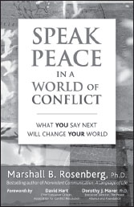

**Speak Peace in a World of Conflict**

_What You Say Next Will Change Your World_

**by Marshall B. Rosenberg, PhD**

Trade Paper 5-3/8x8-3/8, 208pp  
ISBN: 978-1-892005-17-5

International peacemaker, mediator, and healer, Marshall Rosenberg shows you how the language you use is the key to enriching life. _Speak Peace_ is filled with inspiring stories, lessons, and ideas drawn from more than forty years of mediating conflicts and healing relationships in some of the most war-torn, impoverished, and violent corners of the world. Find insight, practical skills, and powerful tools that will profoundly change your relationships and the course of your life for the better.

Discover how you can create an internal consciousness of peace as the first step toward effective personal, professional, and social change. Find complete chapters on the mechanics of Speaking Peace, conflict resolution, transforming business culture, transforming enemy images, addressing terrorism, transforming authoritarian structures, expressing and receiving gratitude, and social change.

**Nonviolent Communication has flourished for more than four decades across sixty countries selling more than 1,000,000 books for a simple reason: it works.**

**Available from PuddleDancer Press, the Center for Nonviolent Communication, all major bookstores, and Amazon.com. Distributed by Independent Publisher’s Group: 800-888-4741.**
