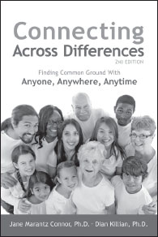

**Connecting Across Differences,** 2nd Edition

_Finding Common Ground With Anyone, Anywhere, Anytime_

**by Jane Marantz Connor, PhD and Dian Killian, PhD**

Trade Paper 6x9, 416pp  
ISBN: 978-1-892005-24-3

**Profound Connection Is Just a Conversation Away!**

In this fully revised second edition, Dr. Dian Killian and Dr. Jane Marantz Connor offer an accessible guide for exploring the concepts, applications, and transformative power of the Nonviolent Communication process. Discover simple, yet transformative skills to create a life of abundance, building the personal, professional, and community connections you long for.

Now with an expanded selection of broadly applicable exercises, role-plays, and activities. Detailed and comprehensive, this combined book and workbook enhances communication skills by introducing the basic NVC model, as well as more advanced NVC practices.

**SAVE an extra 10%** at NonviolentCommunication.com with code: **bookads**
