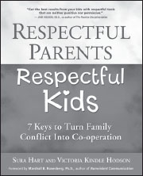

**Respectful Parents, Respectful Kids**  
 _7 Keys to Turn Family Conflict Into Co-operation_

**by Sura Hart and Victoria Kindle Hodson**

Trade Paper 7.5x9.25, 256pp  
ISBN: 978-1-892005-22-9

**Stop the Struggle—Find the Co-operation and Mutual Respect You Want!**

Do more than simply correct bad behavior—finally unlock your parenting potential. Use this handbook to move beyond typical discipline techniques and begin creating an environment based on mutual respect, emotional safety, and positive, open communication. **_Respectful Parents, Respectful Kids_** offers **_7 Simple Keys_** to discover the mutual respect and nurturing relationships you’ve been looking for.

**Use these 7 Keys to:**

  * Set firm limits without using demands or coercion
  * Achieve mutual respect without being submissive
  * Successfully prevent, reduce, and resolve conflicts
  * Empower your kids to open up, co-operate, and realize their full potential
  * Make your home a **_No-Fault Zone_** where trust thrives

**Available from PuddleDancer Press, the Center for Nonviolent Communication, all major bookstores, and Amazon.com. Distributed by Independent Publisher’s Group: 800-888-4741.**
