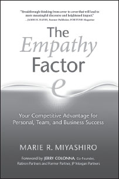

**The Empathy Factor**

_Your Competitive Advantage for Personal, Team, and Business Success_

**by Marie R. Miyashiro, A.P.R.**

Trade Paper 6x9, 256pp  
ISBN: 978-1-892005-25-0

**“Breakthrough thinking from cover to cover. The Empathy Factor will help thoughtful business people add substance and dimension to relationships within the workforce—colleagues and customers.”**

**—JAMES B. HAYES** , **Former Publisher, FORTUNE Magazine**

In this groundbreaking book, award-winning communication and organizational strategist Marie Miyashiro explores the missing element leaders must employ to build profits and productivity in the new economy—Empathy.

_The Empathy Factor_ takes Dr. Marshall Rosenberg’s work developing Compassionate Communication into the business community by introducing _Integrated Clarity_ ®—a powerful framework you can use to understand and effectively meet the critical needs of your organization without compromising those of your employees or customers.

**SAVE an extra 10%** at NonviolentCommunication.com with code: **bookads**
