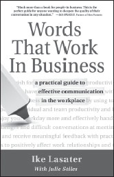

**Words That Work In Business**

_A Practical Guide to Effective Communication in the Workplace_

**by Ike Lasater**  
 _with Julie Stiles_

Trade Paper 5-3/8x8-3/8, 144pp  
ISBN: 978-1-892005-01-4

**Do You Want to Be Happier, More Effective, and Experience Less Stress at Work?**

Do you wish for more respectful work relationships? To move beyond gossip and power struggles, to improved trust and productivity? If you’ve ever wondered if just one person can positively affect work relationships and company culture, regardless of your position, this book offers a resounding “yes.” The key is shifting how we think and talk.

Former attorney-turned-mediator, Ike Lasater, offers practical communication skills matched with recognizable work scenarios to help anyone address the most common workplace relationship challenges. Learn proven communication skills to: Enjoy your workday more; effectively handle difficult conversations; reduce workplace conflict and stress; improve individual and team productivity; be more effective at meetings; and give and receive meaningful feedback.

**Available from PuddleDancer Press, the Center for Nonviolent Communication, all major bookstores, and Amazon.com. Distributed by Independent Publisher’s Group: 800-888-4741.**
