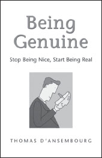

**Being Genuine**

_Stop Being Nice, Start Being Real_

**by Thomas d’Ansembourg**

Trade Paper 5-3/8x8-3/8, 280pp  
ISBN: 978-1-892005-21-2

_Being Genuine_ brings Thomas d’Ansembourg’s blockbuster French title to the English market. His work offers you a fresh new perspective on the proven skills offered in the bestselling book, _Nonviolent Communication: A Language of Life._ Drawing on his own real-life examples and stories, Thomas d’Ansembourg provides practical skills and concrete steps that allow us to safely remove the masks we wear, which prevent the intimacy and satisfaction we desire with our intimate partners, children, parents, friends, family, and colleagues.

“Through this book, we can feel Nonviolent Communication not as a formula but as a rich, meaningful way of life, both intellectually and emotionally.”

**—Vicki Robin,** co-founder, Conversation Cafes, coauthor, _Your Money or Your Life_

**Based on Marshall Rosenberg’s Nonviolent Communication process**

**SAVE an extra 10%** at NonviolentCommunication.com with code: **bookads**
