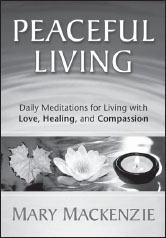

**Peaceful Living**

_Daily Meditations for Living With Love, Healing, and Compassion_

**by Mary Mackenzie**

Trade Paper 5x7.5, 448pp  
ISBN: 978-1-892005-19-9

In this gathering of wisdom, Mary Mackenzie empowers you with an intimate life map that will literally change the course of your life for the better. Each of the 366 meditations includes an inspirational quote and concrete, practical tips for integrating the daily message into your life. The learned behaviors of cynicism, resentment, and getting even are replaced with the skills of Nonviolent Communication, including recognizing one’s needs and values and making choices in alignment with them.

_Peaceful Living_ goes beyond daily affirmations, providing the skills and consciousness you need to transform relationships, heal pain, and discover the life-enriching meaning behind even the most trying situations. Begin each day centered and connected to yourself and your values. Direct the course of your life toward your deepest hopes and needs. Ground yourself in the power of compassionate, conscious living.

**Available from PuddleDancer Press, the Center for Nonviolent Communication, all major bookstores, and Amazon.com. Distributed by Independent Publisher’s Group: 800-888-4741.**
