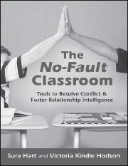

**The No-Fault Classroom**

_Tools to Resolve Conflict & Foster Relationship Intelligence_

**by Sura Hart and Victoria Kindle Hodson**

Trade Paper 8.5x11, 256pp  
ISBN: 978-1-892005-18-2

**Students Can Resolve Their Own Conflicts!**

Offering far more than discipline techniques that move aggressive behavior out of the classroom to the playground or sidewalk, _The No-Fault Classroom_ leads students ages 7–12 to develop skills in problem solving, empathic listening, and conflict resolution that will last a lifetime.

The book’s 21 interactive and step-by-step lessons, construction materials, and adaptable scripts give educators the tools they need to return order and cooperation to the classroom and jumpstart engaged learning—from the rural school to the inner city, the charter school, to the home school classroom. _Curricular Tie-ins_ guide teachers to use the conflict resolution tools they’ve developed to meet state learning requirements in social studies, language arts, history, reading, and science.

**SAVE an extra 10%** at NonviolentCommunication.com with code: **bookads**
