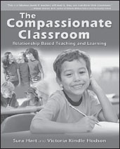

**The Compassionate Classroom**

_Relationship Based Teaching and Learning_

**by Sura Hart and Victoria Kindle Hodson**

Trade Paper 7.5x9.25, 208pp  
ISBN: 978-1-892005-06-9

**When Compassion Thrives, So Does Learning**

Learn powerful skills to create an emotionally safe learning environment where academic excellence thrives. Build trust, reduce conflict, improve co-operation, and maximize the potential of each student as you create relationship-centered classrooms. This how-to guide offers customizable exercises, activities, charts, and cutouts that make it easy for educators to create lesson plans for a day, a week, or an entire school year. An exceptional resource for educators, homeschool parents, child-care providers, and mentors.

“Education is not simply about teachers covering a curriculum; it is a dance of relationships. _The Compassionate Classroom_ presents both the case for teaching compassionately and a wide range of practical tools to maximize student potential.”

**—Tim Seldin** , president, The Montessori Foundation

**Available from PuddleDancer Press, the Center for Nonviolent Communication, all major bookstores, and Amazon.com. Distributed by Independent Publisher’s Group: 800-888-4741.**
