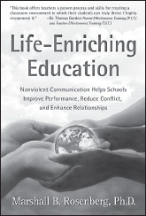

**Life-Enriching Education**

_Nonviolent Communication Helps Schools Improve Performance, Reduce Conflict, and Enhance Relationships_

**by Marshall B. Rosenberg, PhD**

Trade Paper 6x9, 192pp  
ISBN: 978-1-892005-05-2

Filled with insight, adaptable exercises, and role-plays, _Life-Enriching Education_ gives educators practical skills to generate mutually respectful classroom relationships. Discover how our language and organizational structures directly impact student potential, trust, self-esteem, and student enjoyment in their learning. Rediscover the joy of teaching in a classroom where each person’s needs are respected!

**NVC Will Empower You to:**

  * Get to the heart of classroom conflicts quickly
  * Listen so students are really heard
  * Maximize the individual potential of all students
  * Strengthen student interest, retention, and connection to their schoolwork
  * Improve trust and connection in your classroom community
  * Let go of unhealthy, coercive teaching styles
  * Improve classroom teamwork, efficiency, and co-operation

**SAVE an extra 10%** at NonviolentCommunication.com with code: **bookads**
