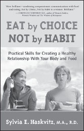

**Eat by Choice, Not by Habit**

_Practical Skills for Creating a Healthy Relationship With Your Body and Food_

**by Sylvia Haskvitz**

5-3/8x8-3/8, 128pp  
ISBN: 978-1-892005-20-5

**“Face Your Stuff, or Stuff Your Face”**

—anonymous

Eating is a basic human need. But what if you are caught up in the cycles of overconsumption or emotional eating?

Using the consciousness of Nonviolent Communication, _Eat by Choice_ helps you dig deeper into the emotional consciousness that underlies your eating patterns. Much more than a prescriptive fad diet, you’ll learn practical strategies to develop a healthier relationship with food. Learn to enjoy the tastes, smells, and sensations of healthful eating once again.

**Available from PuddleDancer Press, the Center for Nonviolent Communication, all major bookstores, and Amazon.com. Distributed by Independent Publisher’s Group: 800-888-4741.**
