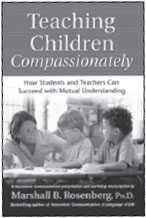

**Teaching Children Compassionately:** _How Students and Teachers Can Succeed With Mutual Understanding_ **by Marshall B. Rosenberg, PhD** • In this national keynote address to Montessori educators, Marshall describes his progressive, radical approach to teaching that centers on compassionate connection.

48pp, ISBN: 978-1-892005-11-3
