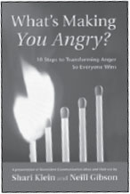

**What’s Making You Angry?** _10 Steps to Transforming Anger So Everyone Wins_ **by Shari Klein and Neill Gibson** • A powerful, step-by-step approach to transform anger to find healthy, mutually satisfying outcomes.

32pp, ISBN: 978-1-892005-13-7

**Available from PuddleDancer Press, the Center for Nonviolent Communication, all major bookstores, and Amazon.com. Distributed by IPG: 800-888-4741. For more information about these booklets or to order online, visit[www.NonviolentCommunication.com](http://www.NonviolentCommunication.com)**

**SAVE an extra 10%** at NonviolentCommunication.com with code: **bookads**
