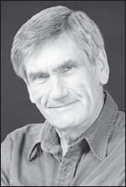

**About the Author**

**Marshall B. Rosenberg, PhD** (1934–2015) founded and was for many years the Director of Educational Services for the Center for Nonviolent Communication, an international peacemaking organization.

During his life he authored fifteen books, including the bestselling _Nonviolent Communication: A Language of Life_ (PuddleDancer Press), which has sold more than one million copies worldwide and has been translated into more than 30 languages, with more translations in the works.

Photo by Beth Banning

**Dr. Rosenberg has received a number of awards for his Nonviolent Communication work including:**

2014: Champion of Forgiveness Award from the Worldwide Forgiveness Alliance

2006: Bridge of Peace Nonviolence Award from the Global Village Foundation

2005: Light of God Expressing in Society Award from the Association of Unity Churches

2004: Religious Science International Golden Works Award

2004: International Peace Prayer Day Man of Peace Award by the Healthy, Happy Holy (3HO) Organization

2002: Princess Anne of England and Chief of Police Restorative Justice Appreciation Award

2000: International Listening Association Listener of the Year Award

Dr. Rosenberg first used the NVC process in federally funded school integration projects to provide mediation and communication skills training during the 1960s. The Center for Nonviolent Communication, which he founded in 1984, now has hundreds of certified NVC trainers and supporters teaching NVC in more than sixty countries around the globe.

A sought-after presenter, peacemaker and visionary leader, Dr. Rosenberg led NVC workshops and international intensive trainings for tens of thousands of people in over 60 countries across the world and provided training and initiated peace programs in many war-torn areas including Nigeria, Sierra Leone, and the Middle East. He worked tirelessly with educators, managers, health care providers, lawyers, military officers, prisoners, police and prison officials, government officials, and individual families. With guitar and puppets in hand and a spiritual energy that filled a room, Marshall showed us how to create a more peaceful and satisfying world.
