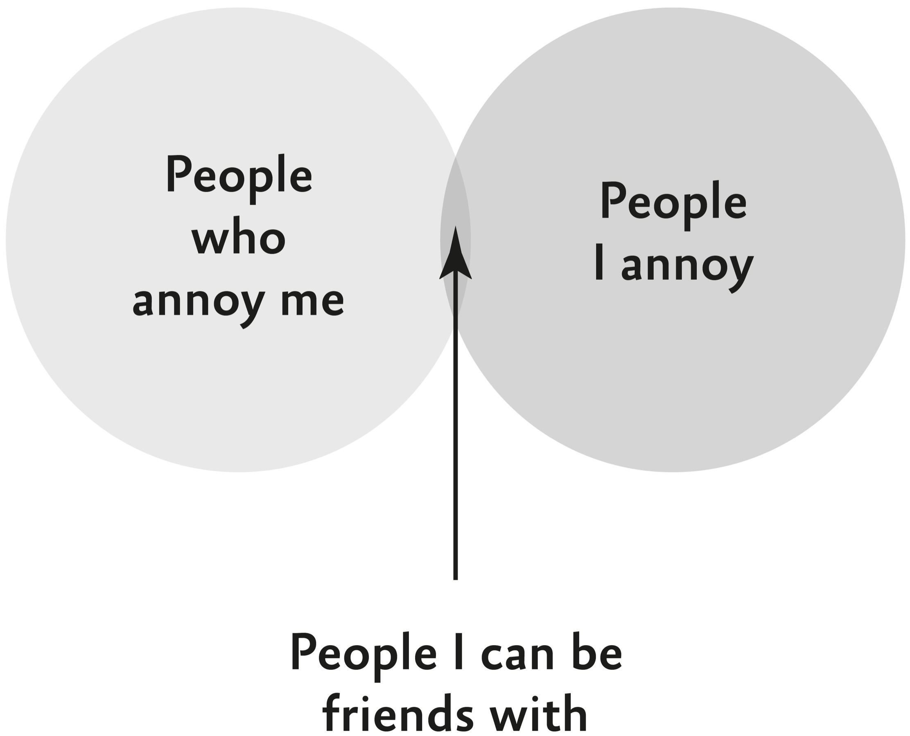

## Chapter 1

Striking a Match

The Building Blocks of Compatibility

Friendship…is born at that moment when one…says to another,

“What! You too?”

—C. S. Lewis

As they pulled themselves into the cramped space, Cady Coleman and Paolo Nespoli knew they were putting their lives in each other’s hands. His heart raced; her hair was standing up straight. Out the window, they saw an object as big as a school bus hurtling alongside them at 17,500 miles per hour. If they didn’t coordinate their motions perfectly, they could collide with it.

It was 2011, and the two astronauts were part of a crew orbiting the earth on the International Space Station. The bus-sized object was a free-flying ship carrying critical supplies, including food, spare parts, and materials for experiments. Cady and Paolo were supposed to catch the ship with a giant robotic arm. The feat had only ever been accomplished once before.

Paolo gripped the control panel, waiting until the ship was in position for capture. His voice shook as he announced, “Free drift.” His mind raced, _Oh my God, this is crazy, this is crazy, this is crazy._ Cady started to maneuver the robotic arm forward and waited for Paolo to confirm that her pacing was perfect, just as he’d done hundreds of times when they’d practiced in the simulator.

But Paolo didn’t give the signal. The ship was just five meters away, and they were in danger of a collision. Without missing a beat, Cady instinctively slowed the speed of the arm. Paolo seamlessly followed her lead. He started giving regular updates on the shrinking distance between the arm and the ship. Seconds later, Cady pulled the trigger and captured the ship. They broke out into big smiles as Paolo said, “Houston, we have no problems.”

They’d come within a split second of failure. Their simulations didn’t prepare them for the visual confusion created by the Earth looming large in the background. That made it hard for Paolo to precisely gauge their distance from the floating ship, a task he’d performed flawlessly in the sim. There wasn’t time to explain that to Cady—and she didn’t have time to tell him she had quickly checked the arm speed and realized she needed to slow down. They had improvised together to make the mission a success without uttering a single word. They knew one another so well that they could basically read one another’s minds. “In the end, that’s what really saved the capture,” Cady told me.

Paolo left me a message from the space station, and we talked when he was back on earth. I was investigating how astronauts vibe, because clashes can be catastrophic when crews are isolated together in a captive environment for extended periods of time. NASA needed to understand how to build and maintain bonds under extreme conditions—a pressing challenge as they prepared to return to the moon and send humans on long missions to Mars. When I asked insiders who to study, they recommended Cady and Paolo’s crew.

As I talked with the two astronauts about their relationship, it was clear that they had something special. Neither of them had spent more than sixteen consecutive days in space, yet on this mission Cady and Paolo orbited the earth together for almost six months. Near the end of their journey, there were rumors of extending their stay. By that point, astronauts are usually itching to go home, but this crew felt differently. Cady said, “I would spend another six months here in a minute, and I would spend it with these people.”

This kind of vibe seems like a miracle of matchmaking. When crews have great chemistry, we figure they’ve been chosen based on compatibility. Compatibility is something we prize in collaborators as well as friends and romantic partners. The assumption is that to have a strong connection, we need to find people whose traits mirror or complement ours. But that’s a myth—and believing it holds us back from bonding with people in our orbit.

When NASA forms crews, they don’t have the luxury of considering compatibility. They don’t look at the mix of personalities—they focus on who has the technical expertise to complete the mission. Cady and Paolo had the specialized skills, but if they’d taken a compatibility test, they would’ve failed. She was affable and calm; he was more headstrong and high-strung. She was a perfectionist—a PhD chemist who played the flute and liked to analyze every detail before making decisions. He was a daredevil who wasn’t afraid to leap before he looked. _Literally…he’s a master parachutist._ They were such a mismatch that the training team was convinced they wouldn’t learn to work together successfully. It wasn’t until training was underway that Paolo and Cady really started to vibe. Their relationship evolved from associates to allies, pals, and eventually companions too.

Compatibility is rarely something we can determine when we meet. It’s usually something we develop as we interact. Instead of leaving chemistry to luck or fate, we can cultivate it. Starting on the same page is optional—landing on the same wavelengths is vital.

Making Friends

![Two pie charts titled “As a Kid” and “As an Adult." The “As a Kid” chart has four segments: a large black segment labeled “Noticing that someone nearby is about the same size as you,” and three smaller slices, a medium dark gray segment labeled “Playing sports,” a medium light gray segment labeled “At school,” and a very light gray segment labeled “At the playground.” The “As an Adult” chart has three visible segments: a large black segment labeled with question marks “?????,” and two smaller slices, a medium light gray segment labeled “Through kids,” and a very light gray segment labeled “Through work.”](assets/page_27.jpg)

### Birds of a Feather

When we call people compatible, we’re saying that their individual qualities go well together. Something in their backgrounds, beliefs, and traits sets them up to vibe. They’re likely to have chemistry and become close.

Compatibility is particularly prized in dating. People scour profiles and swipe left or right based on fit. Some are hoping to find partners who are kindred spirits or cut from the same cloth. Others are looking for the yin to their yang, the Ross to their Rachel, the cheese to their macaroni. Yet the idea of searching for a soulmate suffers from a fatal flaw. In the quest for romance, matchmaking algorithms have fallen short for decades.

You can see it in rigorous studies of speed dating events. Before people meet, they take a compatibility test. They answer questionnaires covering nearly everything about them and their ideal partner. The surveys run the gamut from intelligence to personality to politics—nearly 200 preferences and attributes in all. Then participants talk with a dozen people and rate the connection they felt with them. Surprisingly, the pre-surveys completely fail to foreshadow their vibe.

There isn’t a single quality—or any combination of qualities—that hints at a match.[[*1]](009_c001_Chapter_1_Striking_a.xhtml#footnote-007 "footnote") Even advanced machine learning algorithms can’t construct a crystal ball. One of the psychologists behind the study lamented, “We couldn’t predict compatibility at all.”

This research shatters the theory that opposites attract. Pairing people who seem to complement each other is basically a random walk. Sometimes dreamers and doers make magic together; other times they make a mess. If you put an introvert with an extravert, the quieter person might enjoy listening…or resent an endless stream of unwelcome houseguests. Opposites are just as likely to clash as click.

The evidence also debunks the theory that we vibe with similar people. It’s true that at first, being alike breeds attraction. It’s well-documented that we tend to befriend, date, and hire people who share our experiences, attitudes, and personalities. There’s even evidence that we’re drawn to people who smell like us. But once we get to know each other, similarity has astonishingly little impact on our connection. In an analysis of more than 300 studies with over 35,000 people, having similar opinions and traits had minimal to no bearing on chemistry or closeness between romantic partners or friends. Two extraverts might become the life of the party together…or hate sharing the spotlight. A pair of doers might be in perfect harmony or fight constantly over who does what. As a group of psychologists summarize: “Once its gatekeeper role in relationship initiation is complete, actual similarity demonstrates little or no influence on stable relationships.” Birds of a feather may flock together, but they don’t necessarily fit together.[[*2]](009_c001_Chapter_1_Striking_a.xhtml#footnote-006 "footnote")

We often don’t even pay attention to our own notions of compatibility. When psychologists asked people to describe their ideal partners and then sent them off on blind dates, people ended up being as excited about potential partners who met others’ criteria as their own. This doesn’t mean our preferences are irrelevant—we all have dealbreakers. If you’re a health and fitness maven, you can be confident that you won’t click with a chain-smoking couch potato. My point is that although it’s easy to swipe left on likely mismatches, you can’t judge a good match from a profile alone. It’s true in professional relationships too. Extensive evidence shows that it’s a fool’s errand to try to build a successful team by configuring similar or complementary personalities. It’s nearly impossible to guess whether people will vibe before they meet.

Humans are not like Legos or Tetris blocks. You can’t look at them separately and know whether they’ll fit together. Chemistry and closeness are properties of interactions, not individuals.

Think about someone you know who’s a Nervous Nellie. They make you anxious, so it’s natural to assume they have that effect on everyone. But do they?

Psychologists answer this question by asking you and a bunch of other people to fill out a personality survey. Then you each interact with Nellie and rate how you feel afterward. It turns out that Nellie doesn’t consistently elicit the same jitters in everyone.

Some of your anxiety can be traced back to you—you’re more likely to feel uneasy if you’re a shy person or a worrier yourself. But most of what puts you on edge is your unique pattern of conversation with her. _For starters, you might want to stop calling her Nervous Nellie._ Maybe your discussions with her tend to bounce from one doomsday headline to the next. _Global democracy is in peril and thousands of innocent people are dying in wars that don’t need to be fought and the earth is melting and eggs are overpriced and one of these things is not like the others._ The anxiety emanates from the interaction rituals that emerge between the two of you, not from Nellie herself.

It would be nice if we could catalog Nellie’s traits and yours, plug them into a computer model, and calculate how likely you are to click. The dynamics between people aren’t that predictable. Every pair develops their own rituals—which means that every relationship has its own microculture.

Our separate traits don’t dictate our shared vibe. Scientifically, this is true for all kinds of people across all kinds of interactions. In conversations, how much people dominate, interrupt, listen, and ask questions depends less on their personalities than the rituals they form together.[[*3]](009_c001_Chapter_1_Striking_a.xhtml#footnote-005 "footnote") When adults collaborate and kids play, a great deal of their friendliness and cooperativeness is a feature of their interaction patterns rather than their individual qualities. A group of argumentative colleagues might be simpatico around feeling underpaid; a couple kindergartners who tend to be easygoing might fight constantly over Legos. When friends compete, the amount of trash talk hinges as much on the traditions they create as the tendencies they bring into a game. People who are usually aggressive can build a shared habit of showing respect—and people who are normally polite can get in the groove of poking fun at one another. And in groups, cohesion and conflict are driven less by the individual qualities of members than by the collective norms they develop.

There’s a reason why actors who should be shoo-ins for their parts are called back for a chemistry read with potential co-stars. As natural as a match might look on paper, you can’t know until you see the vibe they create together. At the end of auditions for _The Office_ , the casting team had four finalists for each role. They chose the Pam and Jim who had “amazing chemistry.”

Compatibility is not determined by how we typically act. It’s a function of how we interact. It’s not you or me; it’s us.

### Close Encounters of Four Kinds

In a classic study, psychologists asked hundreds of married couples who they hung out with the most in their buildings. They were four times more likely to name people who happened to live next door than those four doors down. They also made more friends if their apartments were located near mailboxes, stairways, or entries. In a similar investigation at a police academy, cadets listed their three closest friends on the force. They were almost twice as likely to be tight with classmates who sat next to them. The cadets weren’t sorted on compatible traits—they were seated in alphabetical order. The vast majority had found a way to bond with whoever was plunked nearby. _Take that, compatibility tests._

Kids manage to find areas of compatibility with pretty much anyone who’s around too. Elementary schoolers tend to become friends with the classmates seated next to them. Being nearby leads them to interact more, which helps them identify overlapping needs, goals, interests, or values. That paves the way to become associates, allies, pals, or companions.

The better we know each other, the more compatibility we can build. And the type of bond we form with others is not fixed or static. Our connections evolve as our interaction rituals change. We don’t move in stages from associates to allies or pals and finally to companions. It’s not a linear progression; you don’t have to complete one to advance to the next. Relationships can add (and subtract) wavelengths in any order. If you develop some inside jokes with an ally, you might become pals. If you change jobs and no longer have a reason to interact, you might end up becoming associates. And sometimes distant associates surprise you.

A few years ago, my uncle had a stroke and couldn’t access the care he needed. After someone I knew well dropped the ball, a guy I’d met briefly just once stepped up to help. He went so far above and beyond that I started to see him as an ally. Then he checked in regularly for months, proving his potential to become a companion.[[*4]](009_c001_Chapter_1_Striking_a.xhtml#footnote-004 "footnote")

Of course, many of our connections don’t fit neatly into one box. We all have relationships in which we vibe on multiple wavelengths at the same time. Think about your associates. Most of them are just associates; your interactions aren’t emotionally charged. But if your conversations start to gain energy, you don’t leave the associate wavelength altogether. You expand your relationship to include additional wavelengths. It’s hard to imagine an ally, pal, or companion who isn’t also an associate. When you align on goals, interests, or values, you usually find ways to help one another.

Sometimes it makes sense to stick to a single wavelength, but other times it can be constraining. When you catch up with high school friends, if you limit your contact to reunion parties and shallow gossip about your old classmates, you might become prisoners of pal mode. _Stuck in the past._ If you only reach out to a relative when you’re stressed, you could confine your connection to companionship. _Maybe too heavy._ If you only talk shop with your coworkers, you might get trapped in associate or ally terrain. _Probable snoozefest._

The more wavelengths you vibe on, the stronger a connection tends to be. Your go-to collaborators are both allies and pals: You enjoy their company and you share a common purpose. Your closest friends are pals and companions: You can count on them for an exciting night out or a consoling shoulder to cry on. Your ride-or-die may not be your idea of fun, but you’re bound by a pact to have each other’s backs. And your ideal romantic partner lives in all four circles. That’s what makes the relationship so rich—you can be there for one another in every way.

![Diagram showing overlapping relationship roles in a large Venn diagram. The outer circle is labeled “Associate – solves a problem for you.” Three overlapping circles at the center are labeled A smaller circle inside is labeled “Companion – makes you feel seen”; “Ally – makes you think,”; and “Pal – makes you laugh." The overlaps between these three show “Ride-or-die” between Ally and Companion, “Best friend” between Pal and Companion, and “Favorite colleague” between Ally and Pal. “Soulmate” is in the middle where Ally, Pal, and Companion intersect.](assets/07_2P.jpg)

Many people imagine their best friend in the center of the Venn diagram too—especially in the U.S. Whereas people in many Asian, European, and Middle Eastern countries have multiple best friends, Americans are more likely to put one friend on a pedestal. If we don’t have that one friend who’s our go-to associate, ally, pal, and companion, we often conclude that we’ve failed socially. Research shows that even if they’re widely liked, kids feel like outcasts if they lack a bestie. If only they knew that the notion of a “best friend” is a modern invention.

In the 1800s, many people referred to their closest friends as beloved friends, but they didn’t rank them or depend on one for everything. They were onto something. Across multiple studies, people who seek different kinds of emotional support from different friends are happier than those who go to the same friends for everything. That’s true even if they have the same number of close friends. Pals might excel at cheering us up when we’re sad; companions are usually better at soothing our anxiety. We can’t expect everyone in our inner circle to play every role.

Connection is about mutuality, not exclusivity. Understanding wavelengths equips us to develop and deepen bonds. If you identify compatible needs, interests, goals, or values, it’s possible to build a stronger vibe with virtually anyone—whether you seem to match or not. I got to see it with my favorite astronauts, who had to learn to trust crewmates they didn’t really like.

### Houston, We Are a Problem

An American, an Italian, and a Russian walk into space…

It sounds like a bad joke, but it was reality for their crew. Although Cady Coleman and Paolo Nespoli had many differences, that wasn’t their biggest source of tension. They had even less in common with their third and final crew member, Dmitry Kondratyev. Dmitry was a Russian fighter pilot who’d trained to shoot down Americans in combat. He had a reputation for being competent, hierarchical, traditional, and aloof—he liked to work alone and stick to formal channels of communication. That didn’t jive with Paolo’s gregariousness, or with Cady’s tendency to think out loud. They were also looking for different things: Cady and Paolo wanted to get the crew together for drinks, but Dmitry had no interest, which left Paolo feeling puzzled and slighted.[[*5]](009_c001_Chapter_1_Striking_a.xhtml#footnote-003 "footnote") From the start, their personalities clashed as much as their cultures. They seemed incompatible:

![Diagram showing three overlapping circles labeled Dmitry, Cady, and Paolo, comparing their personalities across three rows labeled Extraversion, Decision-making, and Emotional reactivity. Dmitry’s circle contains the phrases “Most comfortable flying solo,” “Never strays from the manual,” and “Might be a robot.” The shaded middle circle for Cady contains the phrases “Even enjoys her in-laws,” “Patiently waiting for Godot,” and “Cool as a cucumber,” with a question mark on each side of her circle, and a larger overlap with Paolo's circle than with Dmitry’s circle. Paolo’s circle contains the phrases “Takes the bull by the horns,” “Ready, fire… aim,” and “Is a human roller coaster.”](assets/08.jpg)

In their early training exercises, they struggled to align. During a landing simulation, Cady flagged an error in Dmitry and Paolo’s calculations. Making it clear that he didn’t trust her to be a true ally, Dmitry dismissed her. Then their capsule crashed.

From then on, Dmitry put Cady in charge of calculations. Yet his willingness to rely on her was limited to the occasional task—she was just an associate. Most of the time, he ignored her. Then in an emergency training exercise, Dmitry put out a fire alone, excluding Cady and Paolo altogether. The message was clear: “I can do this without either of you—I don’t really need you.”

It was alarming. Cady knew that to avoid disaster for half a year in space, her crew needed a stronger bond. _When you’re orbiting the earth together, ghosting is not an option._ Whereas associates tend to prioritize their personal goals above all else, allies put the collective mission first. They had to come together to succeed—and survive. And they were running out of time to vibe.

### Three Peas in a Pod

Cady ended up calling in a leadership trainer, John Kanengieter, who changed their interaction rituals. He asked them to cook a meal together and sit down for a conversation in their crew quarters. Dmitry wasn’t happy about it—he saw it as a waste of time. But after years of helping crews gel, John had a powerful question to build chemistry. _Why did you want to become an astronaut, and how did you get here?_

The crew started telling their origin stories. Paolo spoke about his childhood dream of riding a vehicle on the moon. Cady talked about being mesmerized by spaceflight but never considering it a possibility for a woman until she attended a speech by Sally Ride. Dmitry described his long journey from Siberia to becoming a pilot-engineer to waiting more than a decade to fly into space.

Cady noticed that a softer side of Dmitry came out when his family came up. She went out on a limb and started asking him more personal questions. He started beaming and showing her pictures of his son, and soon they were playing ping-pong together. Although it didn’t magically make them pals or companions, they began to see one another as more than associates.

After witnessing Dmitry’s care and commitment, Cady felt she could count on him. “Recognizing what had made each of us the people we were brought us closer,” she reflects. “Our discussions changed my ideas about who he was and who he could be.” As she put it to me, “We weren’t friends, but we weren’t _not_ friends.” That’s a telltale sign of an ally (or in Russian, a comrade).

Paolo felt similarly. He and Dmitry didn’t become pals, let alone companions. Dmitry was too much of a loner, and it was too difficult to get him to open up. Yet as they collaborated more, Paolo came to see him as an ally. “I respected him,” Paolo remembers. “I would even say I liked him, and I’m ready to share time with him today. Maybe I would not have as much fun as with Cady.”

To shift the vibe between associates, I wouldn’t have suggested talking about their childhoods. I would have advised the crew to discuss their aspirations for the upcoming mission, assuming that would unite them. But a series of studies suggest that to build connection, it’s often more effective to start with the past than the future. When we share our life stories and cultural backgrounds with others, it humanizes us and bolsters our bonds—even if it signals that we’re different from them. When people learn about our roots, they have an easier time making sense of the branches of our lives. Sharing our stories reveals overlapping needs, goals, interests, and values. Compatibility grows with familiarity.

### Side by Side

Opening up came more naturally to Cady than to Dmitry and Paolo. She wondered if that was due to gender as well as personality and cultural differences. Several decades ago, researchers proposed that men and women vibe differently. The thesis was that whereas men typically connect side by side, women tend to bond face-to-face. Basically, men look at a task together, while women look at one another. It fit our stereotypes of women talking over tea and dishing during dinner—and men grunting at the game or the gym or in the garage. Although the distinction makes intuitive sense, it doesn’t hold up to evidence. The way we interact with others isn’t fundamentally gendered. There’s no shortage of men bonding at the bar and women clicking on the tennis court.

We all have both modes of interaction available to us—and which ones we choose can lead us to vibe on different wavelengths. Face-to-face interactions are a natural route to becoming associates or companions. We need to talk to set the terms of our exchange, and to lend one another an ear. Side-by-side interactions are more likely to turn us into allies or pals. We become allies by putting our heads together and pals by rubbing elbows as we hang out and joke around.

The right rituals can spark chemistry between seemingly incompatible people. Recently, social scientists sought to find the short exercise that would be most powerful in building bridges across differences. They collected hundreds of ideas from around the world and culled them into 25 interventions to test. The winning idea came from an unexpected place.

Upon walking into a warehouse, pairs of strangers found boxes with instructions to assemble a bar and some stools out of wood. As they worked together, they naturally chatted about their backgrounds. When they finished building, they saw videos of one another expressing divisive views. They stood on opposite sides of three polarizing issues: climate change, transgender rights, and feminism. Having learned that, would they be interested in sitting down for a drink together? Despite their apparent incompatibility, every pair decided they had enough chemistry to clink glasses.

If it sounds familiar, the activity was originally created for a Heineken commercial. Yep, a beer ad outperformed two dozen interventions submitted by social scientists. (You don’t even have to participate in the exercise to benefit from it—just four minutes of watching other people overcome their differences is enough to reduce partisan animosity by about 10 percent.) Strangers became allies through doing a task side by side, paying attention to the same thing. They moved toward becoming companions by talking face-to-face, paying attention to one another. A common goal opened them up to some compatible values.

* * *

Cady and Paolo almost didn’t get the chance to be partners. During their simulations to practice catching the supply ship, when things didn’t go his way, Paolo wore his heart on his sleeve. _What?! What’s going on here? Damnit! No, do it now!_

The trainers were concerned about incompatibility. They felt Paolo was too loud and opinionated to mesh with Cady, and too passionate and emotional to be steady under pressure. Yet she saw that they were intuitively developing their own code of communication—a language no one else understood. She insisted that they were working well together, and the results they went on to achieve in training backed her up.

Figuring out how to interact with Dmitry cemented their connection. They weren’t just strong allies—the pair became pals too. It wasn’t by accident; Cady took deliberate steps to learn about her crewmates and find compatible interests. She started with food. One day Paolo teased Cady for carrying a granola bar around for lunch, and suggested trekking to a faraway cafeteria because it had the best food. During their extended training around the world, this ritual became a strategy for Cady to build their connection. If she wanted to know how Paolo was doing, she needed to eat with him. He joked that her orders were unacceptable to an Italian: “It’s 1 p.m., Cady. No, you are not allowed to have a cappuccino.”

Paolo and his wife had Cady over for drinks and dinners and introduced her to some of their friends. They laughed about Dmitry not smiling in pictures. And when crew exercises took them from Japan to Germany to Houston, Cady played the flute and Paolo came to watch. At a wine bar, she was jamming when she saw him raise one eyebrow to signal that he was impressed. “I think it brought us closer,” Cady recalls. “You need to know what’s important to people.”

Ultimately, the two ended up relying on one another for emotional support as well. When Paolo found out that red tape would prevent him from doing a spacewalk, he shared his frustrations with Cady. When Cady ran into a brick wall with Dmitry, she vented to Paolo. When they struggled to get Dmitry to consider ideas, they advocated for one another. They didn’t just bring out the best in one another—they became the best of friends. Cady came to count Paolo as a close companion: “He was my space brother.”

A few months into their spaceflight, Paolo received devastating news. His mother had passed away, and there was no way for him to grieve with his family. When Cady asked how she could help, he wondered if she could find a way for him to be “present” at the funeral. She calculated that during the service, the space station would be passing over the European land that was unmistakably shaped like a boot. Paolo was touched that he was able to look out over Italy and honor his mother’s memory. As they floated together, even stoic Dmitry showed some emotion. It didn’t transform their connection as a crew, but it reinforced that they had one—and revealed how far they’d come.

Compatibility is not about being lucky enough to find the right partner. It’s about working together to find the right wavelength.

[Skip Notes](010_c002_Chapter_2_Fast_Frien.xhtml)

[*1](009_c001_Chapter_1_Striking_a.xhtml#footnote-007-backlink "footnote reference") One common dating filter turns out to be totally useless. In a study of over 46,000 marriages in Sweden, the fit between astrological signs had no bearing on whether couples got divorced (or married in the first place). Couples with “compatible” signs didn’t have higher odds of staying together—and those with “incompatible” signs weren’t any more likely to split up. _Good news, Scorpio and Gemini._

[*2](009_c001_Chapter_1_Striking_a.xhtml#footnote-006-backlink "footnote reference") There is some evidence that autistic and non-autistic people tend to communicate and click better with similar neurotypes. However, these differences tend to be smaller when people with autism disclose their diagnoses and when their conversation partners are knowledgeable about it. Real connections can be forged even across real differences.

[*3](009_c001_Chapter_1_Striking_a.xhtml#footnote-005-backlink "footnote reference") You can even see it with mice. Yep, psychologists have put mice in different pairs to track how often they bite and chase each other over a week. Less than a quarter of their aggression is due to their stable mouse traits—while more than half is pair-specific.

[*4](009_c001_Chapter_1_Striking_a.xhtml#footnote-004-backlink "footnote reference") Interestingly, it’s sometimes easier to say no to a close ally, pal, or companion than to turn down a request from a distant associate. It’s called the acquaintance trap. Since the ties are more tenuous, we’re reluctant to reject people outside our inner circles, especially if we have low self-esteem and want their approval. _Sorry I missed your call, Mom—I was busy helping my college roommate’s ex-girlfriend, who I haven’t seen in six years._

[*5](009_c001_Chapter_1_Striking_a.xhtml#footnote-003-backlink "footnote reference") Whereas “integrators” enjoy blurring the lines between work and home, “segmentors” like to maintain a strict boundary. Segmenting personal and professional relationships isn’t just an individual preference—it’s a cultural norm. Thanks in part to the Protestant work ethic, Americans tend to be task-focused on the job: We have associates and allies in the office and save our emotional bonds for home. In many parts of Europe, Asia, and Latin America, people are more inclined to treat their colleagues like pals or companions. In one survey across continents, a quarter of people in Poland and nearly half in India had gone on vacation with their coworkers—compared with just 6 percent in the U.S., where it was rare to even have colleagues over for dinner. (The exceptions might be workaholics, who think it’s inefficient to have pals and companions they don’t work with…or have already turned their existing pals and companions into allies.)
