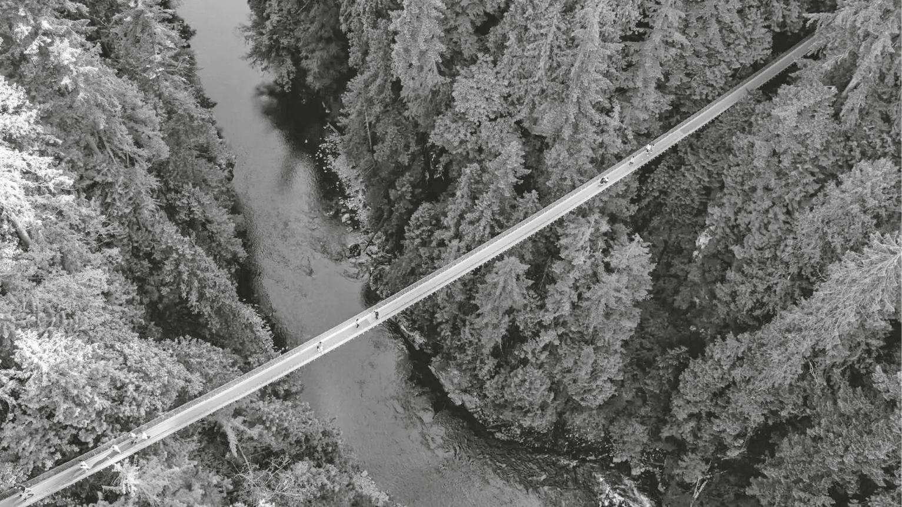

## Chapter 2

Fast Friends

The Art of Accelerating Attachment

There’s not a word yet

For old friends who’ve just met

—Gonzo

One warm spring night in 1971, sworn enemies walked into a packed YWCA auditorium in Durham, North Carolina. The local leader of the Ku Klux Klan stood within striking distance of a Black civil rights activist. They’d both been invited to a community conversation about school desegregation.

The Supreme Court had long since ruled “separate but equal” unconstitutional in public education, but many North Carolina schools remained racially segregated. Local authorities met protests with intimidation and sometimes violence, and a local newspaper called the city a “veritable powder keg.” After a federal order finally forced integration in Durham, the tension escalated.

The task of preventing an explosion was in the hands of a young Black social worker named Bill Riddick. The few times Bill had attempted to mediate community conflicts in the past, he’d been so wound up that he couldn’t keep food down for a full week. In Durham, his charge was to help the community find a peaceful path to school desegregation.

As Bill stepped up to the microphone at the YWCA, he wondered how on earth he could get a White supremacist and a Black activist to find common ground. He decided to kick things off by encouraging open conversation about what was wrong with their schools. But the discussion quickly deteriorated into a shouting match:

C.P. Ellis (White KKK leader): “If we didn’t have n——— in the schools, we wouldn’t _have_ any problems! The problem here today is n———!”

Ann Atwater (Black civil rights activist): “The problem is that we have stupid crackers like C.P. Ellis in Durham!”

Ann was understandably angry, living in a country where she’d faced legal discrimination her whole life. As the daughter of sharecroppers, she grew up being treated as a second-class citizen by White farmers. After marrying at fourteen, she left her abusive husband to raise two daughters by herself and became a civil rights activist. She was known as “Roughhouse Annie,” and even her allies described her as combative; she bragged about her ability to make a Molotov cocktail. She spoke openly about hating White people, often giving them the silent treatment when they walked by, and the one she despised most was C.P. Ellis.

C.P. was raised by an alcoholic father who struggled to make ends meet and cursed Black people when he lost his job. Despite vowing to make a better life for his four children, C.P. toiled in poverty operating a gas station. He internalized his father’s prejudices and became a card-carrying White supremacist. He was president of the Durham chapter of the KKK—his official title was Exalted Cyclops. When Martin Luther King Jr. was assassinated, C.P. cheered and celebrated by inviting his Klansmen to his gas station for a toast.

Ann and C.P. had a history of bad blood between them. At a march a few years earlier, C.P. showed up with a shotgun intending to shoot someone—ideally Ann—but missed his window when the protestors changed direction. Not long afterward at a city council meeting, when C.P. shouted racial slurs, Ann lunged at him with a knife, only to be stopped by her pastor. “I wanted to cut his head off,” she recalled.

Now the two foes were at each other’s throats around school desegregation. After the hostile kickoff at the YWCA, Bill Riddick formed a steering committee to propose solutions to the school board. When Ann volunteered, C.P. signed up too—he wanted to sabotage the process. He pulled up to the first meeting with a weapon in his trunk. When he made a point to show his gun to Ann, she showed him her Bible.

The strife continued in the committee meetings. On multiple occasions, Bill had to physically stand between Ann and C.P. to stop them from throwing punches. He knew he needed to do something dramatic. Instead of defusing the tension between them, he decided to turn up the heat. His aim was to create “an intense reaction” to break the barriers between them overnight.

As I read about his plan, I was skeptical. When a vendetta runs as deep as theirs did, it would be naïve to expect a change of heart after months or even years of effort. Yet Bill believed that when people share emotionally charged experiences, interactions can change swiftly. If he could get Ann and C.P. on the same side of a high-stakes problem, maybe their vibe could shift. And several decades of evidence suggest that he was onto something.

Connection doesn’t have to take a long time. It can happen rapidly when our energy is amplified and aligned. The more we feel together, the faster we bond together.

### The Express Lane

How long does it typically take for two strangers to bond—at the very least, to become more than associates? To find out, communication expert Jeffrey Hall surveyed adults who had recently moved to a new city and students who had just started college about their new connections. He found that even though they were eager to make new friends, it didn’t happen overnight. It took about 50 hours of interaction for a pair to advance from mere acquaintances to friends.

Getting close wasn’t any quicker. To become good friends, on average it took freshmen over 100 hours together—and adults over 200 hours together. Bonding was a slow burn.

This made sense. It’s often said that to cement a connection, there’s no substitute for time. I started telling my students that they shouldn’t expect instant friendship—they needed to build up the kind of history they have with their childhood pals. _Fifty hours to make a friend! A hundred hours to become close pals or companions!_ The time commitment sounded overwhelming. Then I realized something important was missing.

These results were averages—the usual number of hours people needed to bond. When I looked more closely at the data, I saw a more nuanced picture. Underneath the averages was a striking range. Some people took much longer to vibe—and others were far faster. Nearly a quarter of adults turned an acquaintance into a friend within just _five_ hours. Some even managed to make good friends that quickly.

![Chart titled “Hours of Interaction by Relationship Type,” showing stacked vertical bars with hours together on the x-axis \(5, 10, 20, 30, 40, 50, 70, 90, 110, 140, 200, 300, 400, 650, 650+\) and percentage from 0% to 100% on the y-axis. Each bar is divided into relationship categories indicated in a legend: Acquaintance \(average 51 hours\), Friend of friend \(average 165 hours\), Coworker/classmate \(average 165 hours\), Casual friend \(average 75 hours\), Friend \(average 112 hours\), Good friend \(average 223 hours\), and Best friend \(average 737 hours\), showing that at low hours acquaintances dominate and, as hours increase, higher proportions shift toward friends, good friends, and best friends.](assets/09.jpg)

For a plain-text version of this image, go to [this page](028_app_Appendix_Image_Descr.xhtml#image1-appendix).

With both adults and college students, the speed of connection depended on the duo, not the amount of time they spent talking. So what was happening that allowed some strangers to bond faster? You can find an illuminating answer in a Canadian rainforest.

In the early 1970s, various men were hiking near a Vancouver river when a woman approached them. She asked the men to fill out a survey about scenery. When they finished and handed the survey back to her, she tore off the corner of a page and started writing on it. “Here’s my number,” she said with a smile. “If you want to talk further, call me.”

This was all part of a classic experiment, but the psychologists behind it weren’t studying scenery. They were studying interpersonal attraction, and they’d designed two different encounters to see if they could spark it. When they sent a woman named Gloria to collect the surveys, half of the men ended up calling her. When they sent Donna instead, only one out of eight men did.

What made Gloria so much more intriguing than Donna?

The intuitive answer is physical attractiveness. That wasn’t it: Gloria wasn’t prettier than Donna. She wasn’t wearing more flattering attire or more enticing perfume. She wasn’t flirting more enthusiastically either. As she approached the hikers, she looked and acted exactly the same…because Gloria and Donna were the same woman. One research assistant played both characters.

What was the difference? The location. The psychologists had sent their research assistant to approach the men at two separate places in the rainforest—and to introduce herself with a different name in each. “Donna” approached the hikers on an ordinary bridge a mere ten feet above a stream. It was so sturdy and safe that they could cross it with their eyes closed. “Gloria,” on the other hand, met the hikers in a far more precarious place: a long, narrow suspension bridge that swayed 230 feet above rocky rapids. The men had the same conversations with the same woman. But when they happened to meet her in an emotionally intense situation, their odds of calling her quadrupled.[[*1]](010_c002_Chapter_2_Fast_Frien.xhtml#footnote-010 "footnote")

Since the original bridge experiments, the effect of emotional intensity on attraction has been demonstrated dozens of times. Intense emotions boost attraction among women as well as men, and a scary bridge is just one way to activate them. We find strangers more attractive and likable when we’re working out, startled by a loud noise, listening to a crime podcast, or even anticipating an electric shock. When people go to haunted houses together, the more fear they feel, the more they bond—as long as they process the experience together afterward. Under stress or pressure, we’re more motivated to affiliate—we want to tend and befriend. When the stakes are high, we seek connection.

This is why reality TV shows like _The Bachelor_ do extreme dates like skydiving and bungee jumping. They’re not just creating drama to entertain the audience; they’re accelerating bonds between the contestants. Yet faster connections don’t require physical risk or a dangerous place; there are many ways to dial up the intensity of a situation. I’ve seen people quickly turn acquaintances into pals and allies by inviting them to a tough workout or race. Sweating together is social grease. _Running clubs are the new dating app…if you don’t fall head over heels, at least you get to feel the burn._ And one of my closer friendships was formed when a colleague who shared my stage fright went to a public speaking class with me. You can expedite companionship by facing fears together.

It might sound like a trauma bond, but accelerating a vibe doesn’t require pain or shared suffering. _Public service announcement to fraternities, sororities, and secret societies: No hazing necessary._ Connection springs from shared experiences that are emotional or transformational. The active ingredient is not adversity—it’s intensity.

An intense situation is enough to get our hearts racing. But connection depends on getting our hearts to beat in unison. Under the right conditions, even people who aren’t like-minded can swiftly become like-hearted. That’s what Bill Riddick understood.

### Behind Enemy Lines

After Ann Atwater and C.P. Ellis both volunteered to join the steering committee, it came time to appoint a leader. Bill Riddick had a wild idea: He recommended electing two people with diverging opinions to lead. The committee followed his guidance—and Ann and C.P. became co-chairs.

By putting Ann and C.P. in charge together, Bill set them up to become allies. Initially, C.P. only accepted his role to stymie progress, and Ann accepted hers to stop him. When Bill invited the pair to break bread together for the first time, C.P. refused to sit down at the dinner table. He didn’t want to be seen eating with two Black people, so he placed his order standing up. When he eventually sat for the meal, he and Ann only communicated through Bill as a translator.

Bill knew that Durham’s public schools were a mess. Facilities were outdated, fights were common, students were falling behind, and teachers were unprepared for desegregation. Bill urged Ann and C.P. to see that as leaders, they shared a larger purpose. “You have bought into something that is bigger than either of you,” he stressed. “If you two can get together on this, it would change this community forever.”

A few nights later, C.P. picked up the phone and dialed Ann’s number:

C.P.: Look, I don’t like you and you don’t like me. But we got to do something ’cause our kids are suffering in school. If this thing is gonna be a success, you and I are gonna have to make it one. Can we lay aside some of those feelin’s?

Ann: I’m willing if you are.

C.P.: Okay, then. I’ll see you at the meeting tomorrow night.

Taking the reins as co-chairs put them on the same wavelength. Giving them a shared fate forced them to recognize that they were responsible for saving Durham’s public schools. As C.P. concluded, the difference between success and failure “was in our hands.”

Bill had a plan to bring them closer. He knew that to form a new bond, he needed to get Ann and C.P. away from their old attachments. He put the two in a bubble, away from other KKK members and civil rights activists, and gave them just a week and a half to work together.

Through isolation and time pressure, Bill was amping up the emotional intensity of their interaction. He had the perfect bubble: a local school building with air-conditioning sitting empty in the sweltering summer. For ten consecutive days in July, C.P. and Ann worked in that school from morning past midnight. Convening in a separate shared space removed C.P. from his KKK echo chamber and shifted Ann’s attention from protesting to problem-solving. The ticking clock forced them to focus their full energy on the task. The meetings were so grueling that when they paused for a dinner break the second afternoon, C.P. collapsed into a seat beside Ann. “ ’Bout wore _out_ ,” she announced. “Me too,” he said.

Bill hadn’t tried to get Ann and C.P. to calm down or care less. Instead of attempting to neutralize their emotions, he had worked to align their emotions. As Ann and C.P. burned the midnight oil together, they were exhausted together—they didn’t have the energy to put up a front. When they let their guard down, they stumbled onto some compatible goals. Ann was afraid that Black students would be attacked; C.P. was scared that White students would get hurt. They agreed they needed to get in sync on strategies for preventing racial violence. They were both afraid that their own group would lack a voice in the school, so they united on expanding the school board to include an equal number of Black and White student representatives. They had gone from adversaries to begrudging associates, and now they were starting to talk like uneasy allies.

You may not want to vibe with your nemesis. In less charged circumstances, you don’t need a master mediator to bring the intensity. You can create it yourself through showing vulnerability. I’ve seen it happen in my classroom.

![Three-panel comic drawing of a stick-figure man and woman having small talk. In the first panel, the man is saying “Well hey!” while facing the woman, who is replying “Hey! So funny to run into you! Where are you going?”. In the second panel, the man is saying “To the post office. You?” The woman answers “I’m heading back home!” to which the man replies “Cool! Those are places.” In the third panel, the man is saying “That sports team we like!” while the woman replies “They have players!” The text “waitbutwhy.com” is written in the bottom right corner.](assets/Art11_StickFigures_r1.jpg)

### Diving into the Deep End

I’m watching over a hundred students fidget nervously. It’s the second week of class, and I’ve just paired each of them up with someone they’ve never met. They have one minute to see if they can vibe.

That’s the only instruction I give them. When I shout, “Go!” no one says a word. They just sit there, frozen, until a brave soul finally pierces the uncomfortable silence with pleasantries. Then the voices swell into a cacophony. I can’t make out any sounds or read their lips.

Later, I ask them to close their eyes and raise their hands if they’ve managed to form a strong connection. More than three quarters of the hands shoot up.

Since then, I’ve done this exercise with thousands of people. It doesn’t matter where you live or how old you are. In just 60 seconds, the right ritual can light a spark.

This activity was created by my mentor Jane Dutton, a leading expert on high-quality connections. We’ve both run it with people of all ages, and they’re usually stunned by their capacity to click with strangers in only one minute. They don’t know they have an intuitive understanding of how to talk their way to different wavelengths.

Some pairs quickly find a path to becoming associates or allies: They look for compatible needs or goals. _What’s your biggest challenge right now?_ Others take a step toward being pals: They look for shared passions and hobbies. _What’s your ideal way to spend a weekend?_ It’s nice to find common interests, but sometimes it’s enough to take an interest in each other’s interests. The most frequent and surprising approach, though, is to dive right into companionship. _What role does love play in your life?_

There have been many studies about how to accelerate closeness. In the most famous experiments, after just 45 minutes of conversation, strangers end up feeling a strong connection—and maybe even falling in love.[[*2]](010_c002_Chapter_2_Fast_Frien.xhtml#footnote-009 "footnote") This “fast friends” procedure starts with fairly benign questions. _Would you like to be famous? How would you describe a perfect day?_ Then the questions get increasingly personal and intense. _When did you last cry? How do you feel about your relationship with your mother?_

These studies show that short, emotionally intense conversations with strangers can foster strong connections. It takes less time than we expect to advance from small talk to deep talk. But it’s possible to skip the small talk altogether. That’s what my students have learned in the rapid high-quality connection exercise. The short window of time—plus the knowledge that they share the motivation to bond—gives them permission to be vulnerable and go deep right away.

Sure enough, when strangers are randomly assigned to go straight to deep talk rather than small talk, they have a better vibe and end up feeling happier and closer than expected. Although extraverts and introverts get the same joy out of going deep, it gives introverts a bigger boost in connection.

Just nine minutes of getting real can be enough to click. And sometimes taking a risk makes it stick. After a great conversation, a new acquaintance solidified our bond by saying, “I hope this is the beginning of a real friendship.” Vulnerability builds companionship.

“Deep Talk” Icebreaker Timeline

### The Fast and the Curious

In 2014, the Duke basketball team welcomed four freshmen who had never played together. During orientation, the coaching staff invited Robert X. Fogarty, founder of the storytelling organization Dear World, to lead the team through his signature exercise. They were about to venture far outside their comfort zones by writing something deeply personal on their skin.

Robert introduced the exercise by showing the team a portrait of a former football player who wrote three short words on his arm: _No White Flags._ Refusing to give up had always been core to his identity, but it stood for something larger now. He’d been diagnosed with ALS, and he wanted to make it clear to his family that he would fight even harder.

Steve Gleason

The Duke players were asked to write a phrase on their bodies that meant something to them, and then share it with their teammates. Each player received a black marker and started writing. _Master of my fate…Selfless and together…She’s your wings._ Robert photographed them one at a time, and the next day he unveiled their portraits for them to discuss. The star freshman center told his teammates how his mother died when he was nine, and he can still feel her wings lift him up every day. Some of the players shared secrets they’d never breathed to another person. It put them on a fast track to becoming allies and companions—the players said it made them feel like brothers instead of new teammates. They kept the framed photos on the wall, and during March Madness, their coach put them in their lockers. That year, they won the NCAA championship. “There can be no more trust than to tell someone something intimate,” Coach K said. “When a whole team does that…we did become so much closer as a group. It had nothing to do with basketball, but it had everything to do with basketball because it created a more trusting environment…They’re not holding anything back.”

Tyus Jones

The benefits of deep talk aren’t limited to the locker room. Dear World has been a potent bonding experience in settings ranging from a children’s hospital to tech and finance firms—and similar vulnerability exercises have even catalyzed connections between macho men on offshore oil rigs. But we’re usually too reluctant to share something personal about ourselves. _TMI!_

It’s true that if you botch deep talk, you sometimes end up with no talk. Yet these fears are mostly misguided. An analysis of 57 experiments demonstrated that people actually like us better when we show some vulnerability—it displays our humanity and signals that we trust them. My own research has shown that when we disclose a flaw, admit a mistake, or reveal some genuine emotion, others tend to respond favorably. What moves the needle is a disruptive disclosure: an unexpected communication that leads us to rethink our assumptions about a relationship. By jolting us out of our existing rituals, it can alter the trajectory of our interactions.[[*3]](010_c002_Chapter_2_Fast_Frien.xhtml#footnote-008 "footnote")

A disruptive disclosure is not a license to trauma dump. A trauma dump is when people pour out their pain without seeking consent or showing concern for the listener’s boundaries and well-being. It’s unfiltered and self-centered, and it can send the listener running in the opposite direction. A healthy disclosure is different. It involves bounded vulnerability. You’re revealing your humanity without being dysregulated or demanding support. As psychologist Susan David captured it for me, “Share from your scars, not from your wounds.”

One of the best disruptive disclosures I’ve ever seen was on a college tour with my daughter Joanna. We were trudging through muddy piles of melting snow, but she hardly noticed because she was absorbed in a conversation with our tour guide, Natalie. As they discussed the sense of community on campus, Natalie said she had a story that would bring it to life: “A few months ago, my grandma died. Don’t worry—I’m okay. This isn’t a story about me; I want to tell you how people here showed up for me.” Natalie was amazed by the care that her friends displayed. For weeks, they reached out to her multiple times a day. They didn’t tell her until much later, but they’d created a group chat to coordinate their check-ins and let her know that she wasn’t alone.

Natalie divulged something personal without seeming needy or burdening us. That’s what made it a beautiful disruptive disclosure. The topic was intense and vulnerable, but she didn’t burst into tears or pressure us to become her companions. She shared her experience and opened a door for us to choose our preferred wavelength, signaling to Joanna that she could be real too.

To launch a deeper conversation, my students often ask whether it’s better to lead with a disclosure or a question. The answer depends on the context. Different cultures have different norms—personal questions from associates might be judged as rude in Russia or France but welcomed in Brazil or Ireland. What matters most is whether the other person reciprocates.

Healthy vulnerability invites responsiveness. Mutual candor is a building block of relationships: It develops rapport and bolsters bonds. In my work, I’ve found that in successful interactions, both people give and receive. In failed conversations, one person is consistently giving and the other is constantly taking. As psychologist Adam Mastroianni observes, “Givers think that conversations unfold as a series of invitations; takers think conversations unfold as a series of declarations.”

If an interaction becomes a one-sided monologue, you’ve entered the zone of what sociologists call conversational narcissism. “Every experience that we collect is like a little novelty snow globe,” comedian Mae Martin quips. “All human interaction is just basically taking turns showing each other our snow globes…. Someone will be showing you their snow globe…but the whole time your eyes are just darting to your own shelf.” A strong vibe develops when you’re as interested in seeing their snow globe as you are in displaying yours.

Intense Ways to Bond

### On a Wing and a Prayer

For Ann and C.P., the intensity of their situation opened the door to more vulnerable conversation. After one particularly draining day of sessions, C.P. did something unexpected. He posed a personal question to Ann, asking how she was doing. She confided that her youngest daughter had been coming home from school in tears. Her teacher had called Ann a fool for working with a KKK leader, and her classmates berated her. C.P. sympathized: His kids had been bullied as well.

Ann opened up about how her family was so broke that as a child, she had to make her own dolls out of grass, using roots for hair. C.P. broke down into tears—and Ann cried with him. That led them to another shared struggle: Despite teaching their kids not to be embarrassed about being poor, they both felt ashamed of failing to provide for their families.

They hadn’t planned on it, but they’d both made disruptive disclosures, and it challenged them to reevaluate their relationship. Although they were divided by race, they were united by class. “We were caught in this web together,” Ann understood, and up until this point, “we couldn’t see that.” It dawned on C.P. that he and Ann were “two people from far ends of the fence, havin’ identical problems…. From that moment on, I tell ya, that gal and I worked together good. I begin to love the girl, really.”

Soon, Ann was going out on a limb to support C.P. When he confided that his disabled son was having problems with a roommate, Ann marched over to the care facility and got him moved to his own room. Seeing her stand up for him showed C.P. that she cared about him.

Another shared experience brought the former foes even closer together. They went to speak with children about what was wrong with their schools. As they listened, “the blinders came off and we both saw that our fighting one another wasn’t doing anything to help the children,” Ann noted. “And me and him cried at that time, and we began to melt down towards one another.”

It’s hard to imagine an attachment between Ann and C.P. forming today. If they were even willing to walk into the same room, their relationship might be written off as a lost cause. Instead of being nominated as co-chairs, Ann might be stereotyped as too angry and C.P. would probably be dismissed as downright toxic. Yet their story is proof that in the right circumstances, a bitter battle can evolve rapidly into an unbreakable bond.

By altering the terms of their interactions, Bill Riddick propelled a wavelength shift between adversaries. If the two hadn’t been forced to rely on one another to lead an intense process in an intense atmosphere, they might never have ended up becoming allies and companions. In the words of Studs Terkel and Osha Gray Davidson, the journalists who chronicled their relationship, “many small epiphanies” became “the psychological equivalent of a lightning strike.”

### Lightning in a Bottle

When I came across Ann and C.P.’s story, I knew it would be a powerful example of how a vibe can change abruptly. As I compared their arc with the research evidence, though, I was left with an unanswered question. It was clear that the intensity of collaborating on a common wavelength played a vital role in their metamorphosis. But all the relevant experiments had strangers starting on a neutral or positive note, without any history of hostility. No one had put people like Ann and C.P. on a rickety bridge or paired vicious rivals for deep talk. Are these ingredients really enough to turn foes into fast friends?

I found my answer in a landmark study on forging friendships across divides. A team of psychologists went to Seeds of Peace, a summer camp in Maine designed to create connections between Palestinian and Israeli teenagers. They were investigating whether a brief, intense shared experience could foster enduring ties.

During camp, the teenagers played soccer and ate meals together. They also met in groups of 15 for two hours a day to talk about the Middle East conflict. At the end of their three weeks at camp, the researchers asked attendees to name their closest friends. A year later, they followed up to see if the bonds lasted.

Campers who happened to be in the same discussion group were 3.3 times more likely to become tight. That was for teenagers of the same nationality—two Palestinians or two Israelis. What about bonds between two teenagers of different nationalities?

Deep talk was even more potent across boundaries. If a Palestinian and an Israeli were assigned to the same discussion group, they were 15.5 times more likely to become close friends after just three weeks. That’s a staggering effect, and it wasn’t temporary. Over the next year, they were also significantly more likely to stay close.

Discussing charged issues together was more powerful than simply socializing together. More than eating or bunking together, it was going deep on a common wavelength that built bonds across the divide. Within the intense bubble of camp, vulnerable conversation made their connections stronger.

* * *

My new favorite word is _sonder_. It’s the profound awareness that every person you encounter has experienced a lifetime of hopes, fears, loves, and heartaches that you’ll never know. When the writer John Koenig coined the term, he lamented that it made him sad to accept that there would always be some distance between other people’s experiences and his understanding of them.

In my view, sonder is not a form of sorrow—it’s a force for connection. Each moment of sonder is an exhilarating invitation to keep learning new things about our old pals and companions. It’s also a sobering reminder to appreciate how little we truly grasp about the lives of our friends and foes.

At the ceremony to conclude their committee’s efforts, Ann asked C.P. to dance. He refused, but agreed to give a toast instead. He stood up and announced to an audience of hundreds that he was supporting school desegregation. Then, shaking, he tore up his KKK membership card.

He wasn’t alone. Ann ended up letting go of her prejudice too:

There’s been a change in me like the change in C.P. I used to not talk to White people, now I talk to any of them…. At the end, C.P. and I could lock hands and say we won. I don’t know of anything that could change us from being friends.

It didn’t take decades to start moving past their hatred. During that summer of 1971, they went from adversaries to associates in a matter of weeks—and then became allies, pals, and companions in the span of just ten days. “I wasn’t looking for a miracle,” Bill Riddick marveled, but “I got one.”

Ann and C.P. went on to campaign for civil rights together. They talked regularly and looked out for one another. Ann’s granddaughter grew up calling him Uncle C.P. “They weren’t just friends. They became brother and sister,” she reflected. “They never missed a beat, and sometimes it’s as if they could finish each other’s sentences.”

In 2001, the two participated in a documentary about their unlikely friendship. As they linked arms, their vibe was unmistakable:

Ann: We bonded and are still bonded. I feel he’s part of my family.

C.P.: I really love this individual.

Ann: We need to go back out…and start slayin’ and knockin’ down things!

C.P.: If we can get back together again, some boots would be shakin’ in Durham!

In 2005, when C.P. died, Ann gave a eulogy at his funeral.

A strong bond can last for years, but forming one doesn’t have to take years. Sometimes a little heat is enough to build a blazing fire.

[Skip Notes](011_c003_Chapter_3_Love_at_Se.xhtml)

[*1](010_c002_Chapter_2_Fast_Frien.xhtml#footnote-010-backlink "footnote reference") Some critics thought there were preexisting differences between the men who met “Gloria” and “Donna”—maybe the kinds of thrill-seekers who choose to cross a treacherous bridge are more likely to be daring enough to call a woman they’d just met. The psychologists ruled that out by running another experiment focusing only on men who crossed the rickety suspension bridge. This time, the intensity factor was whether “Gloria” approached while they were on the bridge versus ten minutes after they’d crossed it. The men were more than twice as likely to call if they met her on the bridge as after. The original explanation was that they were misattributing their adrenaline rush to the woman, but later studies suggest that this isn’t the case. It doesn’t work if you don’t find the person appealing. Intensity doesn’t manufacture false feelings; it amplifies our existing feelings.

[*2](010_c002_Chapter_2_Fast_Frien.xhtml#footnote-009-backlink "footnote reference") The original fast friends experiment was led by Art Aron—the psychologist who coauthored the bridge study. Recent replications and extensions show that it works just as well by video chat as in person, it’s effective in fostering friendships between kids as young as nine years old, and it may help create lasting bonds. (The research assistants who were guinea pigs for the first deep talk exercise in Aron’s lab ended up getting married.) It works in groups and established relationships too. Swapping embarrassing stories before a brainstorming session is enough to boost the volume and variety of ideas you generate together. Opening up makes you less self-conscious, encouraging you to let your thoughts fly. And deep talk with another couple on a double date can bring you closer to your partner. Even if you don’t plan on a lifelong connection, deep talk can still fuel more rewarding conversations. You may not want to be companions with your hairstylist, but you might find it easy to talk about your insecurities at the barbershop or beauty salon, because you don’t have to worry about being reminded of them every day.

[*3](010_c002_Chapter_2_Fast_Frien.xhtml#footnote-008-backlink "footnote reference") The other way to go deep faster is to ask more revealing questions. We’re too hesitant to do that too. We’re afraid that it will make others uncomfortable and hurt our reputation, but we’re viewed just as positively when we pose sensitive questions as when we float mundane ones. Your standard script might be to ask strangers about their favorite music or their morning routine, but they’ll like you just as much if you ask for their views on abortion or guns—or even if they’ve ever cheated on a partner or committed a crime. Micro-confessions can be liberating.
