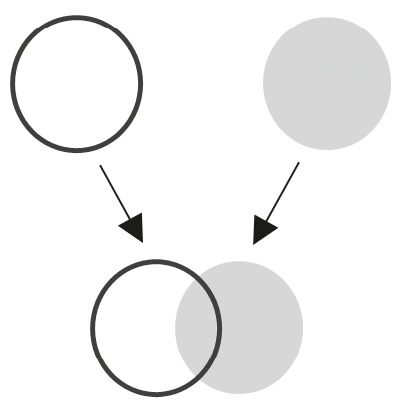
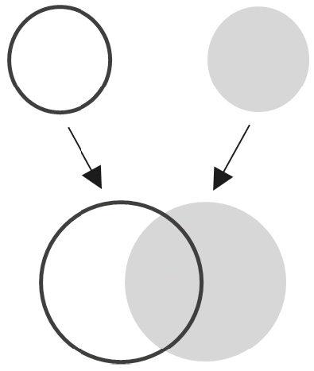

## Chapter 3

Love at Second Sight

The Psychology of Shape-Shifting

Each friend represents a world in us, a world possibly not born until they arrive.

—Anaïs Nin

One day, two friends made a pact that would alter the course of their lives. After years of struggling as a poet, one lamented, “There is too little of what we really like in stories.” Then he posed a challenge to his pal, a word nerd: “I am afraid we shall have to try and write some ourselves.”

So began their double dare. They agreed to draft novels on space travel and time travel and flipped a coin to decide who would get each topic. That decision fueled two of the greatest fantasy series in history: _The Chronicles of Narnia_ and _The Lord of the Rings_.

When C. S. Lewis and J. R. R. Tolkien met, they were unknown academics who wrote fiction on the side—one to find himself and his voice, the other to procrastinate. For the next decade, their novels floundered but their friendship flourished. The writing challenge they embraced put them on a new path together. Tolkien helped Lewis develop his space manuscript, which ultimately became his debut fantasy novel, paving the way for the _Narnia_ series. Lewis encouraged Tolkien not to abandon his time travel draft, which ended up becoming a vital part of his _Lord of the Rings_ series. “We owed each a great debt to the other,” Tolkien reflected three decades later, “and that tie with the deep affection that it begot, remains.”

Many people idealize deep affection as the result of an immediate vibe. They fear that if there’s not a quick click, the relationship is a lost cause. But instant chemistry is not a prerequisite for closeness.

In fact, the people we end up liking the most are sometimes the ones we started out disliking. We have to work harder to rethink their vices and recognize their virtues—and convince ourselves that we misjudged them. That’s what happened with J. R. R. Tolkien and C. S. Lewis.

When the two men first crossed paths in 1926 as new English faculty at Oxford, they promptly got off on the wrong foot. Tolkien expressed disdain for Lewis’s favorite works of literature, snubbing them as frivolous. That night, Lewis wrote in his diary that Tolkien “needs a smack or so.” They soon found more reasons to dislike each other: Tolkien was a devout Christian, and Lewis was an atheist.

In the months that followed, things didn’t improve. Their interactions were mostly limited to mandatory faculty meetings, where they were forced to associate and continued to clash. They were on opposite sides of a fierce rift in the department over what the English curriculum should prioritize. Lewis favored modern literature and scoffed at Tolkien’s preference for ancient languages. He wanted nothing to do with Tolkien’s traditional views and stubborn opinions. Yet when they left the confines of faculty meetings, Lewis started to see another side of Tolkien.

In the hopes of getting his colleagues on board with the idea of studying medieval texts, Tolkien formed a group to read and discuss forgotten Icelandic tales. Lewis decided to go—he had a longstanding passion for Norse mythology. Many months later, Lewis and Tolkien walked out of a meeting together and ended up rhapsodizing late into the night, like a pair of musicians jamming. “I was up till 2.30 on Monday talking to the Anglo Saxon professor Tolkien,” Lewis wrote, “discoursing on the gods & giants & Asgard for three hours.”

It took a shift in their interaction rituals to make their vibe possible. They didn’t have to change their personalities—they only needed to change their context. That set the stage for them to find a shared interest and bond around Thor.

Leading the Icelandic myth group put Tolkien in a different role. Instead of being formal and argumentative, he brought out his curious and whimsical side. He offered pebbles in the form of delightful forgotten words—he loved to introduce his colleagues to Norse terms like _Gandálfr_ (wand-elf). After that book club ran its course, Tolkien led another with Lewis, and they created norms that elicited more playfulness. In their weekly meetings, they read out loud to each other. They sometimes picked the worst novels of their time to see who could go the longest without bursting out laughing. By then Lewis had a nickname for Tolkien. “Tollers,” he said in 1936 as he introduced their bet, “there is too little of what we really like in stories…”

As their relationship changed, Tolkien and Lewis did too. Their animated discussions of literature led Tolkien to take fantasy seriously, motivating him to publish _Lord of the Rings_. And their lively debates about religion converted Lewis to Christianity, laying the foundation for _Narnia._ Their development didn’t just help them forge their masterpieces. It fortified their connection, turning reluctant associates into the closest of pals, allies, and companions. If the two of them hadn’t transformed their vibe, generations of children might have missed out on heroic hobbits and wise wizards and lions and magical portals through wardrobes.

The expectation that chemistry should come instantly cheats us out of connections. So does the assumption that our first impressions are final. We miss out on many potential bonds when we give up after false starts. Humans aren’t static—we’re dynamic. Our personalities shape-shift across situations and over time, and our strongest vibes emerge when we take on new shapes together.

### Wrong at First Sight

In movies, couples fall head over heels the moment they lay eyes on each other and go on to live happily ever after. In real life, psychologists find that “love at first sight” is better described as “lust at first sight.” It’s an immediate physical attraction—not attachment, intimacy, or even passion. And couples who start off with that spark don’t end up being more satisfied together than those who fall in love gradually.

Our snap judgments of people go far beyond physical attraction. It’s well established that after seeing a stranger’s face for just a tenth of a second, we’ve already formed views of how likable, trustworthy, competent, and aggressive they are. In job interviews, more than half of interviewers make up their minds in the first 15 minutes, and over a quarter take just 5 minutes to reach their verdicts.

These first impressions routinely miss the mark. When managers are left to their own devices to interview job candidates and predict how well they’ll perform, on average they barely do better than chance. They apparently missed an important memo from Chris Rock: “When you meet somebody for the first time, you’re not meeting them. You’re meeting their representative.”

Even if people are being sincere, it’s a mistake to make strong assumptions based on small samples of behavior. A thin slice of a person fails to create a well-rounded picture of the prospects for your relationship. I learned this the hard way in the summer of 2016, when I accidentally got into a public fight with Brené Brown, the vulnerability expert and TED Talk superstar.

It started when I published a critique of authenticity in _The_ _New York Times._ I argued that the cultural obsession with “being yourself” can be an excuse for being self-centered, oversharing, and mistreating others. In the article, I quoted Brené’s definition of authenticity. At that point, we’d only met in passing at a conference or two; we were barely acquaintances, let alone associates. I was more familiar with her work, and her definition of authenticity was the most compelling one I’d seen.

The next day, my phone blew up. I was surprised to see a reply to my article from Brené on LinkedIn. She wasn’t pleased. She argued that I was confusing being authentic with being unfiltered. She blasted my argument as “reductionist” and “faulty” and accused me of “misrepresenting and diminishing other people’s work” and “manipulating language to fit your agenda.”

Yikes.

My blood rarely boils. When others are fuming, I have enough equanimity that multiple people have suggested I might be 43 percent robot. But when I read the rebuttal from Brené (and saw thousands of likes and supportive comments), I was mildly outraged. My intent was to get people to think critically about what the unhealthy pursuit of authenticity looks like. I thought I’d given Brené a shoutout, and I didn’t expect a response—let alone a diatribe. I thought it was unprofessional of her to attack my motives and ignore the data that challenged her views. I concluded that Brené was a guru preaching gospel, not a scholar searching for truth. I swore I’d never talk to her again.

It took me too long to discover that I was very wrong about her. And I was wrong about us too.

I should’ve known better. One of the most robust findings in psychology is that we tend to blame people’s worst behaviors on their personalities, not their situations. We do it so often that it’s been called the fundamental attribution error. The driver who cuts you off on the freeway gets labeled as reckless and aggressive—never mind that he might be racing his pregnant wife to the hospital. The restaurant server who messes up your order gets branded as careless—you don’t consider that it’s her first day and they’re short-staffed. The kid who punched me in the nose in second grade was a bully. I didn’t realize until we ended up on the same soccer team years later that as the son of immigrants, he was sensitive to his name being mispronounced. These premature judgments trap us in adversary or acquaintance territory. We don’t even entertain the possibility that there could be times when we’d become associates, allies, pals, or companions.

It’s easy to overemphasize character and overlook circumstances. The person is in the foreground, while the situation is usually in the background or invisible altogether.[[*1]](011_c003_Chapter_3_Love_at_Se.xhtml#footnote-015 "footnote") We compare what someone just did to what _we_ typically do…forgetting that we haven’t seen what _they_ typically do.

If we want to get an accurate read of people, we need to witness them across a range of situations. A team of psychologists did that at a summer camp. To figure out what was consistent about each kid’s personality, they watched every camper for six weeks across a wide range of activities, from woodworking to the playground and meals to cabin meetings. This study was a beast: Each child was observed for an average of 167 hours over 6 weeks and assessed by at least 14 different adults.

The psychologists were hoping to identify who tended toward aggression versus kindness. Sure enough, they were able to spot the meanest and friendliest kids. There was a wrinkle, though. The aggressive kids were sometimes kind, and vice versa.

When they dug deeper, the psychologists realized these uncharacteristic behaviors weren’t random events. The shifts happened in certain situations that differed from kid to kid. One camper was consistently friendly with peers in cabin meetings and woodworking—even when being teased—but consistently aggressive when punished by adults. Another kid lashed out the most after an adult issued a warning, even more than after ultimately being punished. There was also a kid who was regularly docile after adults scolded him and peers teased him—but had the unusual habit of insulting peers who tried to befriend him.

Shape-shifting follows predictable patterns. In the words of psychologist Maria Konnikova, humans tend to be “consistent in our inconsistencies.” For most of the campers, there were specific situations that elicited verbal aggression, physical aggression, whining, compliance, or friendliness. If we only met them in one situation without knowing them in the others, we’d misjudge them.

Relying on our first impressions is shortsighted—it leads us to miss out on the habitual variations in people. As we get to know people more fully, we start to see these variations, which opens up new ways to bond with them.

### Static Dynamics

We think of personality as something we carry with us from one context to another. Yet we don’t express the same traits in every situation—different tendencies are activated by different situations. Our idiosyncratic responses are called our if-then signatures. They capture how we shape-shift and even sometimes reverse from one circumstance to another. If you send me a short email, then I’ll usually respond rapidly. If you send me a long text, then I might never reply.

As soon as I learned about if-then signatures, I noticed them everywhere. I like to keep my desk neat but don’t make my bed. As an elementary schooler, my son was timid at amusement parks with his siblings but fearless on ski slopes with his friends. In his office, Steve Jobs was enthusiastic when pitching his ideas but skeptical about others’ ideas. On _The Office_ , assistant to the regional manager Dwight Schrute is dominant with subordinates but submissive with superiors. (The technical term for that pattern is authoritarianism.) And if you hail from a region with a culture of honor—like Texas or Pakistan—you might be exceedingly gracious to guests in your home but turn nasty if a neighbor insults your family.[[*2]](011_c003_Chapter_3_Love_at_Se.xhtml#footnote-014 "footnote")

Recognizing if-then fluctuations can help us find settings where we might connect. Many strong bonds have emerged between people who clashed in one context and then clicked in another. When they met on a Stanford orientation tour, Larry Page and Sergey Brin bickered about the best way to plan a city and found each other obnoxious and arrogant. But in the computer lab, they hit it off debating whether a full-sized building can be constructed out of lima beans. Eventually they discovered a shared passion for improving online search, and a few years later Google was born. On the tennis court, Serena Williams and Maria Sharapova had an icy rivalry. Post-retirement, with competition and media hype behind them, they’ve become such close companions that they say they’re like sisters. And in classes at school, Bill Berry and Mike Mills despised each other; one was a straitlaced nerd and the other was a punk who did drugs. When they showed up at the same band practice, though, they quickly became pals—and a few years later, they were allies in starting a rock band called R.E.M. Once they aligned on interests and goals, they were able to ride new wavelengths together.

Cars and car seats come with owner’s manuals. They’re filled with instructions to help us operate them correctly and avoid using them incorrectly. Humans are just as complex, but we don’t come with instruction booklets. Some people have solved that by creating their own user manuals to share in new relationships. I’ve seen nonprofit and business leaders, consulting team managers, and journalists exchange one-pagers with new collaborators about how to work with them effectively. If-then information helps us see others’ strengths and weaknesses in context. When you understand what activates people’s virtues and vices, it’s easier to vibe.[[*3]](011_c003_Chapter_3_Love_at_Se.xhtml#footnote-013 "footnote")

It’s particularly helpful to know people’s emotional triggers—the trip-wires that annoy or offend them. _Mine include selfishness, arrogance, lacking integrity, and believing in astrology._ When psychologists asked friends to guess each other’s triggers, the more accurate they were, the less they fought and the closer they felt. I’ve found that understanding others’ triggers is helpful in professional relationships too. In an experiment at a Fortune 500 tech company, I randomly assigned some managers to host a discussion with their new teams about what brought out the worst in them. Over the next few months, they got along significantly better. Once people knew each other’s triggers, they were able to steer clear of them. When there was a conflict or someone’s mood soured, they were able to respond more productively. Instead of blaming unpleasant behavior on character, they realized it was an if-then dynamic in the relationship. _It’s not you. It’s not me. That version of you is a response to this side of me._

### Control-Alt-Delete

After our public feud about authenticity in 2016, Brené Brown and I didn’t speak for four years. We reconnected in 2020, and today I’m proud (and surprised) to call her a good friend.

The turning point came during the COVID pandemic. I was advising an elite sports team on improving their vibe. I’d asked them to talk openly about the problems in their culture, but a few of the star players were resisting. In our initial sessions, several players had mentioned being big fans of Brené, so I decided to go out on a limb and asked if she might be willing to join me for a conversation with the team. Based on where we’d left things, I wasn’t even sure if she would respond.

Brené didn’t just step up—she showed up early and asked me how the project was going. Then she helped me get through to the team. She asked the players why they were wearing so much armor, and one said that toughness was about taking problems in stride, not complaining about them. Brené explained that showing vulnerability is not a sign of weakness—it’s a source of strength. If you can’t talk about what’s broken, you can’t fix it.

Seeing Brené in action with the team made it clear how grossly I had misjudged her. After our dustup, I’d jumped to a conclusion about her personality, ignored the situation entirely, and failed to recognize that I was observing an if-then signature. She told me later that one of her triggers is being quoted out of context—exactly what I’d done with her definition of authenticity.[[*4]](011_c003_Chapter_3_Love_at_Se.xhtml#footnote-012 "footnote") She wasn’t dead set on being right; she wanted to get it right, and she was reacting to me getting her work wrong. It wasn’t the best version of her, but it came in response to one of the worst sides of me.

Collaborating introduced me to the real Brené. When I was seeking her help instead of condemning a caricature of her ideas, it was obvious that she had a big heart. I could’ve seen that if I’d paid attention to her pattern of kindness in stories from multiple people I trusted.[[*5]](011_c003_Chapter_3_Love_at_Se.xhtml#footnote-011 "footnote") She said she’d made a similar mistake—she’d judged my character based on false assumptions about a small sample of my behavior.

Once our roles changed, our relationship did too. The more we’ve learned about each other’s if-then signatures, the stronger our tie has become. We know what to expect from each other during podcasts and fireside chats. If a question comes up, she draws on her deep interviews about people’s life stories, whereas I’m more likely to cite experiments or surveys. If we disagree, she leads with curiosity; I tend to spar. When I argue like I’m right, I sometimes forget to make it clear that I’m listening like I’m wrong. I know that if I go into prosecutor mode, then she might bring her defense attorney to court. We’ve agreed that when experience and evidence clash, we both need to get curious and work through the puzzle together. _It’s so interesting that we’re seeing different things. How can we make sense of that?_

Different if-then patterns are important for different kinds of bonds. To become great companions with someone, it helps to figure out what kindles their compassion and what curbs their judgmental side. If you’re looking to become allies with them, you need to find out how to activate their reliability and integrity—and prevent them from putting something off or just phoning it in. With pals, that’s less important. You just need to know what makes them playful and what kills their joy.

Abraham Lincoln understood this well. When he was building his team of rivals, he recruited one of his toughest opponents, Edwin Stanton, as his war secretary. Although Stanton had insulted him in the past, Lincoln knew they shared a vision of saving the Union and that leadership roles activated Stanton’s tenacity. As they ended the Civil War together, they became so close that Stanton was at Lincoln’s bedside when he died. But they didn’t socialize or have conversations that veered beyond their jobs. Lincoln loved to kibbitz with his friends, and Stanton couldn’t stand his humor. One time after Lincoln cracked a joke, Stanton shouted, “Damn it to hell…was there ever such nonsense?” Having seen his if-then patterns, Lincoln had the good sense to restrict their interactions to work. He knew Stanton was a dependable ally but not a fun pal.

Sometimes all it takes is small signals to produce a shape-shift. One morning at a retreat, I saw a shy attendee carrying a chess board between sessions. When I challenged him to a match, he came out of his shell. He won the first game after an instinctive move to capture my queen; I won the next by setting a trap to pin his king. We spent the next few days in pal mode, teasing each other about our battle of intuition vs. analysis. I had to wait in line for a rematch because others joined in on the ritual.

The more situations we put ourselves in with someone, the more possibilities we have to find compatible needs, interests, goals, and values. That doesn’t mean we’ll hit it off with everyone—some people will let us down. Occasional disappointment is a small price to pay for more chances at meaningful connection. And if we expect a subset of connections to fall flat, it hurts less when they do. It’s like a store budgeting for stolen merchandise or a bank setting aside provisions for bad debt.

> do you wanna be in cahoots with each other
> 
> i don’t have a specific scheme in mind but i think it would be fun to be cahoots

For our part, Brené and I have come a long way. Our connection has grown as our wavelengths have multiplied. We became closer allies as we appeared on each other’s podcasts, shared the stage, and supported each other’s book launches. We started trading advice on writing and speaking—and set my personal record for longest text thread ever. Then we decided to launch a podcast together.

One day we became companions in midair when I reassured Brené that turbulence wasn’t going to cause our flight to crash. I’ve been to her home and she’s met my family, but I’m honestly not sure if we’re pals yet. We’re afraid to play ping-pong or pickleball together—we’re both too competitive in that setting. Our friendship works because we’ve learned to manage our if-then clashes and focus on shared values. Principles of care, humility, integrity, and courage are meaningful common ground.

Common ground, like chemistry, isn’t always something we just come across. It’s often something we cultivate. That involves bigger acts of shape-shifting. If you want to see those shifts vividly, the best pairs to study might be couples falling in love.

### Changed for the Better

One fall in California, a group of psychologists decided to find out what happens as people become smitten. They surveyed college freshmen and sophomores about their romantic status and campus experiences. They also posed a big open-ended question:

Who are you today?

The students had three minutes to write whatever they wanted—a word, a sentence, a sonnet. Most of them jotted down some of their social roles. _Student, tour guide, vegan._ Almost everyone mentioned something about their personality. _Neurotic, kind, hyper neurotic._ Many featured their likes and dislikes. _Hip-hop lover, Impressionist art hater._ Others included their assets. _Tall, blue eyes, trust fund._ And quite a few covered their future goals. _Pre-med, aspiring hand model._

Every two weeks, students spent a few minutes answering that question about who they were. As the weeks passed, the responses revealed who’d fallen head over heels—and who hadn’t. There were clear differences between the identities of the enamored and the unattached. The students who hadn’t found love generally stayed the same: they described themselves in similar ways from October through November. They were still panicking about tests, avoiding French art museums, and moisturizing their hands.

The lovestruck students showed more change in their self-concepts. They didn’t just see themselves more positively—they saw themselves differently. They’d become Beethoven fans who meditated before exams and played handball afterward. They hadn’t lost their previous traits; they still listed those too. They weren’t simply trading one identity for another; they’d broadened their sense of who they were. They’d experienced self-expansion.

Ties can be formed through self-expression, but they’re transformed by self-expansion. Self-expansion happens when a relationship widens your perspective, enhances your knowledge and skills, or makes you a better person. You’re not merely sharing things about yourselves and getting to know each other; you’re growing together. For example, there’s evidence that we earn more money—and end up happier—if our spouses are dependable, organized, and hardworking. Conscientious partners give more support and model better habits, helping us become more like them. And after children learn about nutrition in school, their parents often blossom into healthier eaters. We don’t only benefit from our loved ones’ strengths and interests; we absorb some of them too.

Self-Expression

Self-Expansion

Self-expansion is not just a consequence of a strong vibe—it’s a cause too. Neuroscientists have discovered that the more self-expansion couples experience over half a year of interaction, the more their brains synchronize, and the closer they become. People are more satisfied and committed when they see a relationship as having the potential to help them grow—and when their partners are actively helping them grow. “The very definition of love,” novelist Bonnie Garmus writes, is to “actually _want_ to change for someone else.”

The bonding effects of self-expansion aren’t limited to romantic relationships. If you listen to how people talk about their closest allies and pals, the signature theme isn’t how much they like each other. It’s how much they’ve changed each other. Tina Fey waxes poetic about how Amy Poehler gave her the courage to take comedic risks. Paul McCartney remembers how John Lennon made him less sentimental and more versatile. Matt Damon and Ben Affleck reflect on how they grew together from actors into writers.

Bad relationships confine us to situations that activate our worst selves. Good relationships put us in situations that bring out our best selves. Great relationships introduce rituals that elevate us into better versions of ourselves.

Self-expansion is the most extreme form of shape-shifting. You’re not just adapting to a role—you’re evolving over time. It rarely happens in your first or second encounter with others. As you explore different situations together, instead of merely expressing your existing qualities, you try on new qualities. “Certain people draw out a version of you that didn’t exist before…They witness you, and thus, rearrange you,” writer Maja Wilbrink observes. “We all carry endless hidden selves and latent worlds, waiting for the right gaze to bring them to the surface.” Eliciting unseen sides of each other can shift our vibe to different wavelengths or bring us closer on existing wavelengths. Pals with different interests can introduce us to new hobbies. Companions with different principles can help us identify and express new values. Allies with different skills can turn our attention to new goals.

My friendship with Brené Brown has changed me. I used to default to data and shy away from personal anecdotes. _It’s not about me!_ But here I am, featuring our friendship in this chapter. She’s taught me that my stories can be powerful vehicles for conveying my ideas. After all, I don’t just study connection—I’m muddling my way through living it too, and there are lessons in my trials, tribulations, and occasional triumphs. I’m not promoting myself by shouting, “Look at me!” I’m aiming to offer insight by saying, “I have something to share.” Brené has even persuaded me that every once in a while, I can express a little emotion. _For the record, I still have an intensely logical preference for research studies. Double-blind experiments and Venn diagrams are my love language._

Expanding myself hasn’t only brought me closer to Brené—it’s helped me bond with others on new wavelengths too. Recently a pal I hadn’t heard from in years reached out to confide that hearing me talk about my stumbles helped him feel he wasn’t alone. I’m starting to like this shape.

### Growing Pains

In elementary school, I devoured the _Narnia_ books. They expanded my taste in novels to fantasy, and I remember being mesmerized by the image of a wardrobe leading to new worlds. I had no idea that relationships could be a portal to new selves—for better and for worse.

As our connections evolve and we expand, we keep encountering novel situations. We get a window into new versions of others, and they get to see new versions of us. Not all shape-shifts will appeal to everyone in our lives.

Within a year of their Thor bond, C. S. Lewis and J. R. R. Tolkien became best friends. They went from nerding out on mythology to having deep conversations about their goals, values, and philosophies of life. As they went from associates to pals, allies, and companions, they stretched each other in fundamental ways.

Much of the self-expansion happened in their second book club, the Inklings. For 16 years, they met weekly to read literature, talk over food and drinks, and sharpen one another’s work. There were no formal rules, but there were plenty of interaction rituals. “Out would come a manuscript and we would settle down to sit in judgement upon it. Real, unbiased judgement too, for about the Inklings there was nothing of a mutual admiration society,” Lewis’s older brother recalled.

As they exchanged ideas, Lewis and Tolkien grew together. As their views on religion and fantasy literature evolved and aligned, their writing capabilities expanded. Lewis “was for long my only audience,” Tolkien noted. “Only from him did I ever get the idea that my ‘stuff’ could be more than a private hobby.” They refined their early drafts of _Narnia_ and _The Lord of the Rings_ together, based characters on each other, and their budding careers took off.

After two decades of friendship, though, Lewis and Tolkien started to grow apart. Rather than applauding Tolkien’s creativity and commitment, Lewis grumbled about his endless stream of ideas and his perfectionistic penchant for rewriting. Instead of appreciating Lewis’s ability to connect with a broad audience, Tolkien looked down on Lewis’s prose and parables—and deemed him too productive and not pious enough.

The Inklings had stopped gathering, and their rituals had changed. Their hours of exchanging pebbles, helping each other, and laughing together disappeared. Instead of looking for ways to recreate the playful, developmental spirit of the Inklings, Tolkien and Lewis mostly read one another’s work from a distance, which elicited a different if-then dynamic. As their tie became more transactional, they operated more like associates. They stopped supporting each other as allies, sharing joy as pals, and showing care as companions. As they began to drift apart, Lewis confided in a letter to Tolkien, “I miss you very much.”

Then a new relationship drove a bigger wedge between them. Lewis got married to a woman who’d been divorced. Tolkien viewed it as a betrayal of his faith, failing to appreciate how far Lewis had already come on religion. Their friendship fizzled due to a change in context and fractured due to a change in Lewis.

Tolkien thought he was being true to himself, but he failed to do right by his friend. Eventually, he came to regret the rupture too. After Lewis died, Tolkien wrote that whereas loss normally felt “like an old tree that is losing all its leaves one by one,” this felt “like an axe-blow near the roots. Very sad that we should have been so separated in the last years.”

* * *

Snap judgments prevent bonds from beginning and precipitate their ending. Like humans, vibes are complex and evolving, and they thrive when we treat them that way. We can gain chemistry as we change the situation and get closer as we change each other. We grow closest as we allow each other to change.

[Skip Notes](012_p002_Part_2_Sustaining_Co.xhtml)

[*1](011_c003_Chapter_3_Love_at_Se.xhtml#footnote-015-backlink "footnote reference") Some psychologists argue the bias toward character attributions only exists in Western cultures, where individualistic worldviews prevail. In Eastern cultures where collectivism is more pronounced, it may be more common to acknowledge context, as people are expected to change based on the norms of their groups. However, research has returned mixed results. It may be that character attributions are common around the world, but collectivistic cultures are more likely to consider the situation in tandem.

[*2](011_c003_Chapter_3_Love_at_Se.xhtml#footnote-014-backlink "footnote reference") The most striking evidence on cultures of honor comes from a study in Major League Baseball. After their teammate was hit by a pitch, do pitchers retaliate aggressively by hitting an opposing batter? It turns out that pitchers are more likely to throw these retaliatory beanballs if they were raised in the Southern U.S.

[*3](011_c003_Chapter_3_Love_at_Se.xhtml#footnote-013-backlink "footnote reference") My favorite way to find out what activates your virtues is to use a tool called the Reflected Best Self exercise, which is based on research by my colleagues at the University of Michigan. After collecting short stories from 10 to 20 people about times when you were at your best, you compose a portrait of your strengths in context. Think of it as your personal highlight reel, but the camera doesn’t just zoom in on you as the main character—it zooms out to show the setting and the supporting cast. You get a mosaic of specific situations where you shine. Instead of just hearing that you’re kind and considerate, you might learn that you’re unusually thoughtful in picking out gifts for pals or showing up for companions in crisis. And if you want to figure out what brings out your vices too, classic research shows that it helps to describe the worst collaborator you’ve ever had. What bothered you most about them? If your least favorite colleague was incompetent, irrational, unreliable, or unmotivated, it’s a sign that you lean task-oriented. If your dreaded coworker was disrespectful, selfish, arrogant, or rude, you might be more relationship-oriented. If your nightmare coworker was all of the above, you may be the victim of some very bad luck.

[*4](011_c003_Chapter_3_Love_at_Se.xhtml#footnote-012-backlink "footnote reference") My view of authenticity has evolved. “Authenticity is the daily practice of letting go of who we think we’re supposed to be and embracing who we are,” Brené writes. It’s the “choice to let our true selves be seen.” To quote her in context this time, she found that it involves “the courage to be imperfect, to set boundaries, and to allow ourselves to be vulnerable” and “the compassion that comes from knowing that we are all made from strength and struggle.” I agree. Authenticity without boundaries is careless. Authenticity without empathy is selfish. Being true to ourselves is not a justification for being unkind to others. As David Sedaris put it, “Be yourself. Unless yourself is an a**hole.”

[*5](011_c003_Chapter_3_Love_at_Se.xhtml#footnote-011-backlink "footnote reference") It’s not enough to pay attention to how someone treats you across different situations. The test of character is how they treat different people across different situations. In eight studies with over 8,000 participants, people who consistently acted like a**holes online tended to act like a**holes in the real world too. Even if someone is kind to you, proceed with caution if they’re consistently unkind to others—especially those they don’t like or need. Trolls use aggression to get attention, and selective civility is a sign of deep-seated hostility.
