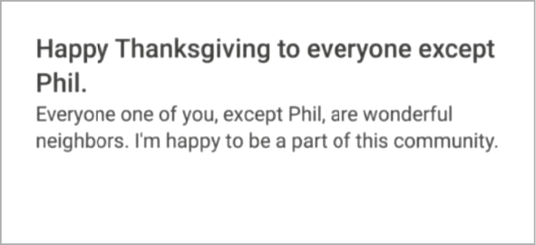
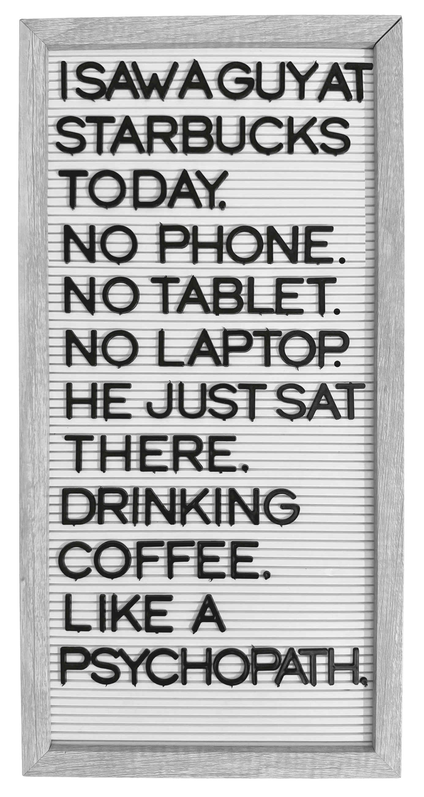

# Part 2

Sustaining Connection

The Rituals of Resilient Relationships

One of my favorite people on the internet is a man named Riley Enright. Well, he isn’t technically on the internet; his daughter is the one who posts about him. Riley is in his sixties and lives in Wisconsin. He’s a family man, a die-hard Packers fan, and a health insurance consultant. He loves to fish, and he’s biked across the state and run a marathon to raise money for charity.

Every Friday at 4 p.m., Riley has a standing meeting on his calendar. It’s with three friends he’s known for three decades—a neighbor, a work ally, and a high school pal. They get together at a bar, but he calls it a board meeting. Because each week, Riley shows up with a typed agenda of topics to discuss, which have included:

  * Packers Playoff Picture

  * Jimmy H’s mom says 70 yr old Jimmy is on the naughty list

  * Elves are getting bigger

  * Favorite Christmas song and movie

  * Dream vacation

  * China and Russia

  * New head shaver

  * General Discussion

Riley’s daughter Kenzi started posting her dad’s agendas online in 2022, and they immediately went viral. Hearts around the world melted, and it wasn’t just because people found Riley adorable and his topics endearing. They were moved by the energy he invests in staying close to his friends.

In a world where connections feel increasingly fleeting, we long for enduring bonds. For most of human history, it was easier to tend to relationships. For generations, people lived in tribes and villages with their associates, allies, pals, and companions nearby. As early towns and cities emerged, people still didn’t have to put much thought into maintaining ties. They settled neighborhoods with their closest companions, worked with a consistent set of allies as farmers, carpenters, or bakers, and bumped into their old pals and associates in the marketplace.

In the modern world, that consistency of contact with a stable group of people is gone. Our hyperconnectivity is no match for our hypermobility. Young people are averaging only about a year of tenure before job-hopping. When we take a new role, we leave our old allies behind. When we pack up for a different city or country, we abandon many of our pals and companions. We don’t even bother to tell our associates we’re leaving. And the more frequently we relocate, the shallower and more disposable our connections become.

Think about your closest friends right now. They might be the companions you’d call for emotional support, or the pals you’d ask to help you move some furniture. Now imagine a decade has passed. Will you still have the same vibe with them?

According to the data, the odds are slimmer than we expect. Sociologists find that in seven years, only 30 percent of your pals and companions will be in that same role—and only half of them will be in your life at all.

Kids lose friends even faster. Of the friendships fourth and eighth graders have in September, a quarter are over by June.

Of course, not every relationship is meant to last. People come and go in our lives; connections serve different purposes, and a lapsed link isn’t necessarily a failure. At work, it’s common for temporary allies to revert to associates once deadlines pass or projects end. In our personal lives, some degree of drifting apart from pals and companions is reasonable too. Many studies demonstrate that we get more selective about relationships over time. Our happiness in our fifties is predicted by the number of interactions we have in our twenties, but it depends on the depth of interactions we have in our thirties.

Still, most of us wish we were better at staying connected. We have fewer strong ties than people did in the past, and more of our ties are limited to a single wavelength. Our daily routines increasingly drive us more toward isolation than connection, making it difficult to maintain rich relationships. Our commutes are longer and lonelier. We’re not grilling with our neighbors next door; we’re asking to borrow their grill using Nextdoor. Instead of having friendly conversations, they often make demands and pick fights:

![Screenshot of a Nextdoor-style post reading: “Please help. I’m out of butter. please drop a stick at the corner of \[street name blurred\] and \[street name blurred\] between 2 and 4 am today \(Sunday\) I don’t want to meet people, I don’t want new friends, I just need butter. Butter is important to me.” Several phrases, including “I’m out of butter,” “drop a stick,” and “meet people,” are highlighted.](assets/page_86_2.jpg)

Our inner circle is mostly out of range. Only a quarter of Americans live near most or all their closest friends, and nearly half are surrounded by few or none. Online social networks once promised to keep us connected. Yet instead of interacting with friends, people now spend the majority of their social media time watching videos created by strangers.

Between home and work, people used to keep relationships going at “third places.” They maintained meaningful connections at cafés and bars, libraries and bookstores, barbershops and beauty salons, parks and bowling alleys, or churches, synagogues, and mosques. Now our more consistent stops are the gym and coffee shop, where we block out the world with our devices.

In our frenetic lives, the contact we do have is often filled with distraction. A photographer illustrated it vividly by taking people’s devices out of their hands just before taking their pictures, showing them alone together:

Men in particular are struggling. In a survey across the U.S., the U.K., Canada, and Australia, over half of men had no companions for emotional support. Instead, they have more distant associates and allies. Men also have fewer close pals than in the past—it’s been called the male friendship recession. And the burden typically falls to the women in their lives to nurture their bonds. Cue the _Saturday Night Live_ sketch where women take their boyfriends and husbands to hang out at the man park.

We don’t need a dog park for dudes. To maintain our vibes, we need to rethink our rituals. That’s what Riley Enright has done so masterfully with his board meetings at the bar. But we don’t have to mimic his Friday afternoon meetup or print out a plan for conversation. What matters is the intentionality, not the formality. There are countless ways to design our own habits for keeping ties alive.

Intentionality is especially important to sustaining connections through difficulties as well as distance. Over time, every bond faces strain. We don’t just struggle to stay in touch; we’re not sure how to get back in touch. We ruminate about whether to accept people’s flaws. We get into fights and fail to resolve our differences. All these challenges are inherent to lasting relationships, and they aren’t insurmountable. They call for different sets of strategies.

The rituals that spark, strengthen, and shift connections are rarely the same as the ones that sustain them. To build resilient relationships, we need to change our expectations about the cadence of contact, our techniques for handling complications, and our stances on conflict.
