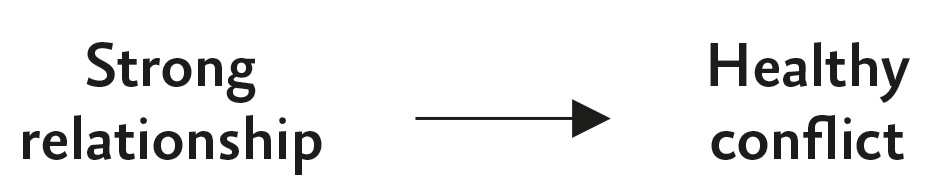

## Chapter 6

Good Vibrations

Creating Harmony from Disharmony

Before you criticize someone, you should walk a mile in their shoes.

That way, you’ll be a mile from them, and you’ll have their shoes.

—Jack Handey

In 2001 an iconic rock band was in crisis. They were preparing to record their eighth album while their bassist was on the verge of quitting. In a desperate attempt to keep their vibe alive, they did something few rock stars would consider. They went to group therapy.

The conflict had been brewing for a long time. Early on, in the heat of an argument about which encore song to play, the frontman punched the drummer in the stomach. They clashed about who was in charge and what kind of music to make. Their producer said working with them felt like “going to war,” with the lead guitarist stepping in “to keep the peace.” Now their fate was in the hands of a mild-mannered therapist in his early sixties named Phil Towle.

After working as a marriage counselor and a gang counselor, Phil had transitioned to performance coaching. His specialty was helping sports teams improve their relationships, and he’d recently started working with bands too. When he showed up to meet the four rockers for the first time in room 627 of the San Francisco Ritz-Carlton, he knew he’d have his work cut out for him. The bassist made it clear that he had no patience for psychobabble. He asked Phil to leave and told the others that bringing in a therapist was “f*cking lame and weak.” Then he announced that he was done with the band.

From out in the hallway, Phil heard the bandmates yelling and decided to poke his head back in the room. Taking in their icy glares, he suggested that the three remaining members start working through their issues with him. Reluctantly, they agreed. They started holding regular sessions with Phil—multiple hours a day, multiple days a week. They ended up putting him on retainer to be on call 24/7. He told them they needed to rethink their instincts about how to salvage relationships.

Phil didn’t encourage the band members to fight less. He challenged them to fight more—and more openly: “The purpose of conflict is to bring people closer.”

We tend to romanticize strong vibes as natural, seamless, and easy to maintain. Conflict feels like a threat, so we often go to great lengths to avoid it. But the real threat is the act of avoidance itself. Sustaining connections is not about steering clear of confrontation—it’s about summoning the courage to embrace it. The road to maintaining connection is rarely smooth, and sometimes the best way to stabilize a bond is to shake the ground beneath it. Once it resettles, it’s possible to build a stronger foundation.

Under Phil’s guidance, the band started having more arguments, and they got more heated. In spring 2002, they finally reached a boiling point. After several days of jabbing and bickering, the drummer’s temper flared. He started to unload on the frontman for being self-centered and controlling:

Drummer: I want to say “f*ck” a lot to you. When I was running this morning, and thinking about seeing you today…the word “f*ck” comes up so much…. I just think you’re so f*cking self-absorbed…. All these rules and sh*t—man, this is a f*cking rock & roll band, I don’t want f*cking rules…. I’m somewhere around the halfway point of my life…and it’s just not f*cking worth it.

Then the drummer stood up, got in the frontman’s face, and screamed: “F*ck. F*ck. F*CK!!!”

Although the band had expressed plenty of rage through their music, in conversation the drummer was normally more stoic. In twenty years together, it was the most explosive confrontation they’d ever had. Multiple people in the room felt that it was the last straw—the band was doomed.

The following year, they ended up releasing their eighth album. It debuted at number one on the _Billboard_ chart, topped the charts in 30 countries, and won a Grammy.

“It’s the vibe,” the frontman said.

“We’ve grown a lot,” the drummer concurred. “Because of Phil, we have the best relationship we’ve ever had…. he saved the band.”

The guitarist even said, “If Lennon and McCartney had Phil, the Beatles would never have broken up.”

Since then, the band has released three more albums, won two more Grammy awards, landed rock artist and rock album of the year, and made the Rock & Roll Hall of Fame. You probably know them as the most successful heavy metal band of all time: Metallica.

Some perpetual problems can be solved. Friction is not a bug; it’s a feature of sustaining relationships. Conflict is necessary and even useful for maintaining ties over time. _Ideally before we start shouting expletives._ To find our greatest harmony, we need moments of disharmony.

### You _Can_ Handle the Truth

The summer we started dating, Allison and I got tickets to see the Gin Blossoms perform outdoors. Concerts aren’t my thing; I’d been to a grand total of one ever. But I’d heard their music playing in her car, so I figured it would be a fun pal activity. After several hours of sitting on the grass—as far as possible from the speakers, clouds of smoke, and other humans—Allison admitted that she wasn’t a big fan of concerts either. We would’ve both been happier watching a movie at home, but neither of us mentioned it. We didn’t want to introduce any awkwardness or cause any problems so early in the relationship. We failed to uncover our real preferences because we were avoiding friction.

Interpersonal friction is the tension that exists when people discover conflicting preferences, interests, goals, or values. Friction takes different forms on different wavelengths. Associates face friction when homeowners don’t see eye to eye with a painter or landscaper on a bill. Pals run into friction when they disagree on whether to do karaoke or see a rom-com and whether it’s okay to date each other’s exes. Allies face friction when they’re divided on whether to meet in the morning or at night, and whether to keep working on their startup or shut it down. Companions encounter friction when one person wants to resolve a conflict right away and the other wants to cool off first—or when one person offers solutions when the other is just seeking support. If friction recurs or escalates, we might reach the point of questioning whether we want to stay associates, pals, allies, or companions at all.

In physics, friction is a force of resistance, but it’s also a source of motion. In a car, the friction between your tires and the road enables you to change directions when you turn the steering wheel and accelerate when you step on the gas. On a violin, friction with the bow allows the strings to oscillate and produce a sound. Without friction, a pair of sticks can’t generate a chemical reaction to start a fire, and a pair of people don’t have neurochemical reactions to each other. Friction is a source of intensity. It can help us get unstuck and move forward together.

Think about someone in your life who does something that bothers you. In a few minutes, you’re going to tell them how you’d like them to change. How do you think it will go?

People were sent to do exactly that in a series of experiments, and they weren’t optimistic. They feared that the tension would be uncomfortable, the recipients would react negatively, and it would damage their relationships. But when they spoke their minds, the opposite happened. Two weeks after delivering the honest feedback, they felt significantly closer to the recipients. Remarkably, the recipients felt the same way.

In _Think Again_ , I wrote about the value of friction for opening minds. I highlighted how building a strong relationship enables people to have healthy conflict. What I didn’t realize is that the reverse is also true: Healthy conflict can strengthen relationships.

How We Think Conflict Works

How Conflict Actually Works

Friction is rarely as destructive as we fear. Across more than a dozen studies, people were too pessimistic about the consequences of being direct with friends, roommates, relatives, coworkers, and partners. They fixated on what could go wrong and overlooked what might go right. They didn’t realize how much others would appreciate the chance to improve—and how their vibe could improve as a result. They missed out on repairing relationships because they underestimated their shared capacity to handle friction.

The discussions we dodge are more likely to deepen our bonds than destroy them. If we can’t be honest, what we’re maintaining is less of a relationship than a charade. Connections stagnate in silence. Candor opens the door to growth.

### We Need to Talk

Recognizing the upsides of friction can motivate us to confront it head-on. In one experiment, married couples who were asked to spend just 21 minutes reflecting on the good that could come from their biggest fight were more likely to stay satisfied with their relationship over the next year. In another experiment, students and adults were instructed to either downplay disagreement (“it’s no big deal”) or consider the benefits of disagreement (“it helps our relationship grow”). Although minimizing conflict felt better, it left people less inclined to tackle disputes head-on. When people saw the value of arguing, they gained confidence in their carrying capacity for conflict. They knew they could not only tolerate it but grow closer through it—and became determined to face it.[[*1]](015_c006_Chapter_6_Good_Vibra.xhtml#footnote-028 "footnote") That’s what Phil Towle pressed Metallica to do.

When I reached out to Phil to understand his therapeutic approach, I asked how he knew where to start. I’d already seen him in action thanks to a documentary, _Some Kind of Monster_ , which captured Metallica making their eighth album—including some of their coaching sessions with Phil. As I watched him with the band, read about their work, and talked with him, I recognized his core framework, tools, and process. His first step was getting the band to stop fearing confrontation.

For years, Metallica had done everything in their power to avoid conflict. When disagreements arose, they suppressed them in hopes of getting back to the good old days. When the bassist quit, the foundation shook, and they needed Phil’s help to keep the band from collapsing. Frontman James Hetfield and drummer Lars Ulrich were supposed to be allies, but their visions collided so often that they weren’t even pals anymore—they were barely hanging on by an associate thread. The tension was so severe that James and Lars were refusing to say a critical word about one another’s work altogether, fearing that one comment could cause an earthquake. In their eyes, friction was bad—it signaled disharmony and threatened their future.

As Phil coaxed the band to stop tiptoeing around conflict, they started speaking up during jam sessions. One day James admitted he was unhappy with the drumming—the beat was clever but confusing. Lars explained that he thought James’s guitar segment sounded unoriginal. They were starting to get more candid, but the tone was passive-aggressive, and it escalated quickly into a shouting match filled with name-calling and cursing. James stood up, stormed out, and slammed the door hard. The next day, he didn’t come back. The rest of the band wasn’t sure if he would ever return—and if Metallica would survive.

The band was finally having necessary conflict, but it was the destructive kind. Phil wasn’t daunted. He knew that getting into the ring is only the first step. The next phase of growth is learning how to have a good fight.

![Diagram titled “Things to say during an argument,” showing a semicircle spectrum from helpful to unhelpful phrases, with darker shading toward the unhelpful side and a thick arrow pointing right. On the helpful side, the arc labels read “How do you see the situation,” “Let’s take a break*,” and “How can we compromise,” with a pill-shaped label below saying “Helpful” and a footnote at the bottom: “* Helpful unless you’re dating.” Moving rightward, the middle phrase is “I get that,” and the unhelpful side includes “You’re becoming hysterical,” “What’s wrong with you,” and “#SORRYNOTSORRY,” with a pill-shaped label below saying “Unhelpful.”.  “Liz Fosslien” is written in the lower right corner.](assets/page_136.jpg)

### Saying the Magic Words

In response to honest feedback, people frequently get angry and defensive. It’s possible to shift the vibe with 19 words that open people up.

In a pair of powerful experiments, middle schoolers drafted essays, and their teachers wrote suggestions for improvement. The students were much more receptive to criticism if their teachers included a note: _I’m giving you these comments because I have very high expectations and I know that you can reach them._

This simple preamble was a game changer. It transformed the meaning of the interaction. The 19 words communicated supportive intentions, signaling that teachers weren’t attacking or judging, but coaching. That motivated students to make more revisions to their essays and submit better final drafts.

It wasn’t a mixed message; the teachers didn’t express ambivalence about the essays. They separated what they were saying (their critiques) from why they were saying it (their desire to help). Students opened up to criticism because they understood that it came from care—a small communication that can make or break all kinds of conflicts. How a confrontation goes depends less on the message itself than the motives we convey.

I’ve learned to introduce friction with a similar preface: _I’m sharing this because I care about you and our relationship._ If it doesn’t land, it’s a signal that I haven’t done enough to establish my desire to help the other person and bolster our bond. It’s surprisingly easy to hear a hard truth from someone who’s trying to make you better—and your vibe better. When commitment is clear, candor shows care.

This is not an endorsement of the compliment sandwich, as Stewie Griffin called it on _Family Guy_. The popular approach is to stick the meat of your critique between two slices of praise, but the available evidence suggests that the sandwich doesn’t taste as good as it sounds. We tend to remember what happens first and last in a conversation, glossing over the middle. When you start and end with positives, it’s all too easy for the constructive criticism to get buried or discounted (especially if you’re talking to a narcissist). Even if that doesn’t happen, the positives might not be believed. People know you’re trying to butter them up and soften the blow, so they don’t take your compliments seriously. A more effective approach is to ditch the second slice of praise and serve an open-faced sandwich that separates the positive and the negative. _I have notes on strengths and areas for growth—which would you prefer to hear first?_ Another option is to just deliver the growth message with supportive language: _You know what would make you even more effective?_

![Comic-style drawing titled “HOW TO GIVE CRITICAL FEEDBACK – STATE YOUR POSITIVE INTENT THEN SERVE IT UP STRAIGHT,” showing five hands, three on the left, two on the right, holding plates with open-faced sandwiches, each next to a different supportive feedback phrase: On the left, “I’M GIVING YOU THIS FEEDBACK BECAUSE I BELIEVE IN YOU AND YOUR POTENTIAL…”; on the right, “THIS MAY BE HARD TO HEAR NOW BUT I HOPE IT’LL HELP YOU IN THE FUTURE…”; on the left, “I’M SHARING THIS BECAUSE I CARE ABOUT YOU…”; on the right, “I’D BE FAILING YOU IF I DIDN’T TELL YOU THIS…”; and on the left, “I’M SHARING THIS BECAUSE I’D WANT SOMEONE TO DO THE SAME FOR ME….” There is a small vertical credit on the right reading “@RESEARCHDOODLES BY M. SHANDELL.”](assets/Art41_CriticalFeedback.jpg)

Once we’ve communicated our concern, healthy conflict rests on being frank and kind. Even if we’re ending a relationship, candor is often more welcome than we realize. After early dates, ghosting is common; people just stop responding rather than breaking it off. Research reveals that ghosting rarely reflects a lack of care—it’s usually a misguided effort to shield others from pain. In a pair of experiments, after people exchanged texts with a confederate for a few days, they were either ghosted or directly told “I am not interested in talking with you anymore.” The two groups felt equally bad at first, but over the next few days, people felt worse if they’d been ghosted than dumped. Being ignored hurts more than being rejected; ending a relationship without explanation is a blow to our self-esteem, belonging, and sense of clarity, closure, and control. Even just writing “I don’t think we’re a romantic match, but I enjoyed meeting you” elicits positive responses from many recipients (and leaves senders feeling better too). The truth may sting briefly, but silence leaves an open wound.

The objective is not brutal honesty. As author Bob Burg cautions, “Those who take pride in being ‘brutally honest’ are typically more interested in being brutal than they are in being honest.” The goal is to be as clear as possible in what we say and as caring as possible in how we say it.

In unhealthy relationships, we’re forced to choose between honesty and loyalty. We bite our tongues to preserve fragile ties. In healthy relationships, honesty is an act of loyalty. We speak our minds to improve our vibes.

### Making Waves

Constructive conflict is easier on some wavelengths than others. With allies, the need to rely on each other to achieve a shared goal is a strong source of motivation to get in sync. With pals, the arguments are typically shallower, which makes it natural to keep things light and defuse tension. Laughing during and after disagreements is one of the most effective ways to maintain a healthy bond.

With companions, it can be more complicated. Paradoxically, when our bonds are built around care, we sometimes bring our worst selves to arguments. It often unfolds in three steps:

  1. Avoid confrontation. I don’t want to make a big deal out of taking out the garbage.

  2. Watch resentment build. Does he think the garbage is going to take itself out?!

  3. Blow up. “YOU DON’T DO ANYTHING AROUND HERE!”

We care so much that we avoid confronting our companions, and when we finally do it, we take that care for granted. _He loves me, so he’ll forgive me._ But if we’re not careful, a feud about who takes out the garbage can leave us feeling that we just can’t take it anymore.

Across wavelengths, the culprit behind many failed arguments is not what we’re arguing about—it’s how. Phil Towle told me that in conflict, the biggest mistake people make is demanding that the other person change. “I come in wanting _you_ to solve _my_ unhappiness,” he explained. Instead, we should recognize that we’re stuck in a pattern that isn’t working anymore and evolve our rituals to become happier together.

It’s possible to invent healthier rituals for confrontations themselves. One of my favorite Instagram posts asked people to share their wildest marriage hacks, and the responses were full of creative ways to fight like pals. There’s a family that wears party hats during arguments and one that holds weekly “beef sessions.” There’s a couple that acts like sports fans by playfully booing each other’s misbehaviors. One pair presents their squabbles for friends to judge in a Supreme High Court of Petty Grievances. It started on a Saturday morning after the husband offered his wife breakfast in bed, and she was mad that he woke her up. “I lost that case but that’s the judicial system for you,” he lamented. One day my kids were bickering in the car, and I was tired of pleading with them to stop fighting, so I told them they could keep arguing as long as they were all smiling. It became a game they play from time to time. _Pal mode activated._

Good friction rituals don’t just lighten the mood—they reinforce that we’re on a shared wavelength. One couple solidifies companion status by holding hands during arguments. Another goes into associate mode, charging each other small fees for minor inconveniences (there might be a five-cent fine for leaving hair on the sink and a ten-cent fine for forgetting to close the garage again). Some blend ally and pal mindsets by building block towers or Lego sets together during conflict. There’s even a couple who came up with a clever way to lock in as allies before long car trips: “We have a pep talk to remind ourselves we are not enemies—the children are our enemies.” And I’ll never forget the couple who kept the peace while working from home during the pandemic by blaming their problems on their imaginary coworker Ryan: “Ryan was a real piece of work and left trash everywhere and lights on. He was an HR nightmare.”

Heated conflicts benefit from distance. I used to believe in resolving issues right away, but I’ve learned that’s a mistake. _Never go to bed angry_ leaves us fighting when we’re angry—and tired. There’s wisdom in saving some of our disagreements for later or designating a specific time for them. Some couples swear by weekly meetings to work through their issues. And sometimes it’s easier to raise what’s on our mind after taking a step back and looking at other people’s relationships.

In an experiment, newlyweds were randomly assigned to watch and discuss movies together. It was a light commitment—only one film a week for a month, followed by an hour-long conversation. Yet it had a lasting effect. Three years later, they were about half as likely to get separated or divorced as the control group.

Movie night wasn’t just a form of couples therapy. It was as effective as receiving extensive training in empathetic communication or conflict resolution skills. Although more research is needed to replicate that finding and unpack why, my hunch is that movie night made it fun and productive to work on their marriages. Instead of diving right into their thorny issues, they were able to temporarily put their baggage aside and connect on a shared wavelength. Laughing at romantic comedies like _Fools Rush In_ and _As Good As It Gets_ put them in pal mode; tearjerkers like _Love Story_ and _Steel Magnolias_ activated companionship. Analyzing dramatized examples of what couples did right and wrong—and what they could learn—made them allies.

It helps to be on the same page during discord. Too often, friction pits us against each other. The right rituals remind us that we’re on the same side against Ryan.

![Cartoon showing two panels comparing conflict styles. In the top panel, labeled “Unhealthy Conflict,” a person in glasses and a striped shirt labeled “YOU” is facing a person with a bun and crossed arms labeled “ME,” with a scribbled cloud between them and the text with “vs." below it. In the bottom panel, labeled “Healthy Conflict,” the same two people are standing side by side, labeled “YOU + ME,” with a speech bubble from the "ME" person containing a small scribble with an arrow, facing a separate scribbled cloud labeled “THE PROBLEM,” with “vs."  at the bottom between the two and scribbled cloud. The artist’s name “Liz Fosslien” is written in the lower right corner.](assets/page_141.jpg)

### Jumping to Conclusions

When Metallica’s frontman James Hetfield stormed out in 2001, he didn’t come back. After a long battle with substance abuse, he’d ended up checking himself into rehab. For many months, he had limited contact with the rest of the band, leaving them largely in the dark about his progress. Drummer Lars Ulrich confided to his bandmates that he felt disrespected—and feared that if he didn’t bite his tongue, James would never return.

After nine months away, James finally rejoined the band. His outpatient recovery plan limited him to working four hours a day. To avoid being excluded, he insisted that the band only record when he was with them from 12 to 4 p.m. One day when he found out that they broke his rule, he slammed the door and walked out again.

In organizational psychology, there’s a model that illuminates why this happens and helps us harness friction productively. It’s called the ladder of inference. The core idea is that conflict is rarely caused directly by other people’s actions. It’s usually the result of how we interpret them. When people do something that bothers us, we climb up a ladder from observations to assumptions to conclusions.

![Diagram of the ladder of inference showing parallel perspectives labeled “Lars’s view” on the left and “James’s view” on the right. The ladder has three horizontal rungs labeled, from bottom to top, “Observations,” “Assumptions,” and “Conclusions.” Under Lars’s view, the observation reads “James isn’t communicating,” the assumption reads “James is deliberately keeping me out of the loop,” and the conclusion reads “James doesn’t respect me.” Under James’s view, the observation reads “The band is playing without me,” the assumption reads “The band is deliberately excluding me,” and the conclusion reads “The band doesn’t respect me.”](assets/43_LarsView.jpg)

This isn’t unique to heavy metal bands. We do it in all kinds of relationships. Observation: _You didn’t rinse your dish off after dinner._ Assumption: _You were only thinking of yourself._ Conclusion: _You don’t care about me._

The longer frustration festers, the more time we give those false conclusions to build and burn. We talk past each other. We attack each other. We create caricatures that exaggerate one another’s worst qualities.

We’re remarkably bad at mind reading. We don’t know other people’s motives or reasoning, and we’re too quick to invent our own. Faulty assumptions lead us to jump to unfair conclusions, and the confrontation goes off the rails. _How could you possibly think that? Do you have any idea how stressful my day was?_

Many people recommend avoiding these misunderstandings by making more charitable interpretations: “Assume good intent.” But not everyone has earned the benefit of the doubt, and we rarely know other people’s intentions. Most of the time, we’re just guessing. The point of the ladder is to remind us to stop making assumptions altogether. It’s not enough to try to _take_ their perspective, because we’re likely to guess wrong. A better remedy is to start a dialogue with open questions to _get_ their perspective. _I must be missing something—can you tell me how you saw the situation and help me understand what’s really going on? I know I can’t read your mind, so would you be willing to read it to me?_

Remembering to ask rather than accuse requires humility—and it’s the responsibility of the listener, not just the speaker. The ladder only works if both sides are willing to acknowledge their flawed assumptions. If you can’t admit you were wrong, you can’t make it right.[[*2]](015_c006_Chapter_6_Good_Vibra.xhtml#footnote-027 "footnote")

I’m often surprised at how useful the ladder of inference is. Last year, one of my allies was taking a long time to reply to emails. I assumed our project had fallen down her list of priorities, but I didn’t say anything, because I’m a chicken. After drafting this chapter, I realized I was failing to practice what I teach—which was stalling our progress and hurting our vibe. I took the leap and called her to raise it:

Me: You’re extremely conscientious, so I’m mystified by the fact that you sometimes go radio silent for a week at a time. Can you help me understand the disappearing act?

Her: I don’t want to spam you with little daily emails, so I wait until I have everything compiled into a big update. Would you rather hear from me more regularly?

Me: Definitely! I’ll be less worried about things falling through the cracks, and I respond faster to short notes than long ones.

That phone call shattered my false assumption—what I took for unreliability was actually an expression of thoughtfulness and thoroughness. It helped us align on a cadence of communication that worked for both of us and made us better allies. Now we have a simple ritual that helps us raise friction directly: _Can we walk down the ladder?_

![Diagram showing two parallel ladders labeled “My view” on the left and “Her view” on the right, each with three rungs labeled from bottom to top “Observations,” “Assumptions,” and “Conclusions.” On the left ladder, the Observations rung has the text “Her replies are delayed,” the Assumptions rung has “This project isn’t a priority for her anymore,” and the Conclusions rung has “She’s uncommitted and unreliable.” On the right ladder, the Observations rung has “He gets a lot of email,” the Assumptions rung has “Frequent messages are annoying,” and the Conclusions rung has “I’m organized and helpful.”](assets/44.jpg)

That ritual doesn’t always lead us to identical conclusions, but it does help us see each other’s intentions more clearly. The highest compliment from someone who disagrees with you is not _You were right._ It’s _I never thought of it that way_. Conflict doesn’t have to produce consensus; it only needs to promote understanding. To paraphrase William H. Whyte, the greatest barrier to communication is the illusion that it has occurred.

### A Walk to Remember

I first learned about the ladder of inference in my early twenties, when I trained as a conflict mediator. I had no idea that two decades later, I’d end up using my training to mediate a marital conflict in front of a live audience.

During the pandemic, I was in the middle of a virtual book event with author Glennon Doyle when she sought my advice on a recurring conflict with her wife, soccer star Abby Wambach:

Glennon: When Abby orders pizza, we have five people in our family…she might come home with five pizzas. And then I will judge her, and then I will be annoyed, and then she will feel sad…So, this is an issue for us. Too much food, not enough food. Over-ordering, under-ordering. I think we fight about it once a week.

They were gridlocked. Abby had given up hope on solving the dispute. She’d said it was exhausting—they should just agree to disagree.

![Four-panel comic drawing of two simple, round-faced characters having a conversation. In the first panel, the character on the left, with short hair, is saying “I’M MAD!” while the other character stands silently. In the second panel, the right-hand character is holding up a rectangular object and saying “HERE’S A SOLUTION.” In the third panel, the left-hand character is holding the object, now on fire, saying “I DON’T WANT A SOLUTION.” while In the fourth panel, the left-hand character is saying “I WANT TO BE MAD.”, and the words “POORLY DRAWN LINES” are written along the bottom edge.](assets/Art45_Mad.jpg)

It was time to get Glennon and Abby to walk down their ladders. Even if it didn’t fix the issue, it might help them unpack each other’s views. I’d known Abby for a few years, so I asked if she was home. When Glennon shouted for her to come in, Abby had no clue what was about to go down.

Me: Abby, we wanted to put you onstage to resolve a conflict in your marriage. Are you cool with it?

Abby: Yeah, totally. Which conflict?

Me: I heard a rumor that sometimes you might order 17 extra pizzas. What’s going on here?

Abby: I grew up in a big family…. Sometimes you’d finished everything on your plate and then all the food was gone. So, in me, I have a total fear of scarcity—like there will not be enough. And to be the person that is in charge of our entire family’s intake, I don’t want anybody to experience that feeling of scarcity. So those two things smushed together force me to order more than we probably need.

Me: What an inexpensive way to feel secure. Most people pay thousands of dollars for therapy when they’re dealing with those kinds of demons, right? And here you can order some extra pizzas. I feel like that’s a good deal.

Glennon’s observation was that Abby ordered too much pizza. She walked up a step and made assumptions: “Abby doesn’t care about conserving food or saving money.” As it happened repeatedly, the conflict escalated, and Glennon found herself at the top of the ladder with a conclusion: “Abby is wasteful.” From then on, any time Abby over-ordered anything, Glennon fell victim to confirmation bias: “That’s _so_ Abby. She always does this.”

Once Glennon saw that Abby wanted to shield their family from the fear of food scarcity, she reached a new conclusion: Abby was being caring, not careless. And Abby realized Glennon was trying to be careful, not controlling.

Having understood each other’s priorities, most couples would compromise by ordering three pizzas.[[*3]](015_c006_Chapter_6_Good_Vibra.xhtml#footnote-026 "footnote") The risk is that they’d both end up unhappy—or the more accommodating person would always give in to the more stubborn one. A workaround would be to discuss how important the issue is to each of them and defer to the one who cares more. But our discussion led Glennon and Abby to a better alternative: They would commit to eating the leftovers.

Agreeing to disagree avoids conflict. Disagreeing more agreeably makes it possible to resolve conflict. Yet developing rituals for friendlier arguments is not always a smooth transition. It’s like tuning a radio: To find a better frequency, you have to put up with a little static interference.

Ambiguous Feedback Translator

Feedback: |  Translation:  
---|---  
Think outside the box |  That was a very bad idea  
This is almost there |  I don’t know what I’m looking for  
What in the hell were you thinking? |  My nervous system is dysregulated  
We need to be smarted about this |  You need to be smarter about this  
That was an interesting choice |  You screwed that up  
Great job this quarter |  I just remembered I was supposed to give you feedback  
  
### Master of Puppets

After slamming the door on Metallica for leaving him out of recording sessions, James came back the next day. A few days later, they were in a session with Phil when James announced that he didn’t trust Lars and didn’t enjoy making music with him. Lars stood up and walked out. His bandmates went to see where he was and found him walking in circles around a ping-pong table in the next room.

Phil wanted them to recognize that they were taking steps to show that they cared about each other. When James had stomped out the previous week, Lars had followed him to make sure he was okay. Now James had gotten up to check on him. James announced that there was one form of communication that was off-limits for Lars:

James: Not slamming doors. That’s mine.

Lars: You got the market cornered on that one…. You and my wife should have a contest.

They all burst out laughing. They’d started to rekindle their pal vibe. Phil challenged them to talk about how to be better allies and companions:

James: I want to feel some trust. [to Lars] I just feel static all the time from you.

Phil: What would it take for you to trust him?

James: I have no idea…. [to Lars] Do you believe in trust? Do you think it’s important?

James and Lars were starting to tune the dial on their relationship. By acknowledging the friction between them, James was inviting Lars to share his perspective. Lars recognized that James was on a different ladder and asked him to walk down it:

Lars: Part of my problem with you is that I don’t understand…Okay, I have a reality, he has a reality, we all have our different realities. I have never in my life felt as disconnected from you as I do at this moment. So part of getting more connected to you is me understanding your realities…. I’m trying to get closer to you by finding out what these things mean to you.

James: I felt like it was an agreement. We were gonna work from twelve to four, and then we would not work.

At that point, their producer and temporary bassist, Bob Rock, stepped in to show James their ladder. He told James he was making the wrong assumption. They weren’t trying to leave him out—they were trying to help move the album forward in his absence.

Bob: We love you, we care about you…. it’s not because we want to do something behind your back. It’s for you.

Lars [to James]: I know the hardest thing about you leaving at 4 o’clock is that you don’t really want to leave…I know you want to stay past four and keep jamming…and that’s what makes me hang on, ’cause I know we want the same thing.

James: I’d like to play. What do you think, Lars? I would just like to put out there that whatever it is that you want to tell me, I will open my heart as big as I can.

That invitation was the moment when Lars launched into his f*ck rant, berating James for being selfish and overbearing. James’s first impulse was to punch Lars, but he didn’t escalate the conflict. Instead, he made a move toward reconciliation:

James: Thanks for sharing that…. there was a lot of good stuff I got out of that—a lot of insight into you…. it showed a vulnerable side…. And that was the way it was meant to be.

James and Lars had come to see that their friction wasn’t about diverging goals. It was about the best way to achieve a shared goal. They were ultimately allies—they wanted to make great music together. They didn’t say sorry, but they didn’t have to. They’d already proven their commitment to repairing the relationship through their words and actions. They’d expressed desires to feel trust and get closer. They’d shown care by seeking to understand each other and checking on each other. As the saying goes, the best apology is changed behavior.

After walking down the ladder and working through their friction in therapy for months on end, Metallica was finally ready to start handling conflicts on their own. When they told Phil they wanted to scale back his sessions, he resisted. In his efforts to help the band, he’d become so enmeshed with them that he struggled to let go. In the documentary, you can see Phil become something of a common enemy—the band ends up uniting against him. But over the years, many musicians have found it transformative to see Metallica learn to disagree more agreeably. James hopes there’s “acceptance in the world for Phil and his role and what he’s done for us, ’cause he did take us to the place that we were afraid to go to. He did walk us into the fire, and walked us onto the other side.”[[*4]](015_c006_Chapter_6_Good_Vibra.xhtml#footnote-025 "footnote")

It didn’t happen overnight, and it didn’t happen alone, but learning how to have constructive confrontation ended up saving the band—and strengthening their bond.

Over the next two decades, James and Lars continued to evolve their rituals. They still disagree constantly, but they no longer avoid it. They know that just as great music progresses from dissonance to consonance, relationships evolve through tension and resolution. By embracing friction, they’ve gained insight into each other’s ladders—and each other’s triggers too.

Lars: We know much more about who each other is, and we know how far we can push each other…there’s much more of a partnership going on than there used to be. Now we’re not fighting to win an argument…We will fight for each other.

They’ve become stronger allies, doubling down on their mission to push the boundaries of heavy metal. They’ve also connected on new wavelengths, becoming real companions as they’ve learned to lead with care, and even occasionally apologize on the way to repair:

James: What works for me with Lars is we just sit down and just start talking about our kids…a completely loving place to start…and then all of a sudden it’s like…I’m sorry I did this and…now you can move on…. It’s lasted longer than all the marriages in the band…we hate each other, and we love each other, and it morphs, it changes, but at the end of the day we realize, this works. And we’re a good team.

The strength of a vibe is not determined by whether we fight. The question is whether fighting drives us apart or brings us closer together. In the moment, constructive confrontations disrupt harmony. Over time, they expand our capacity for harmony. The purpose of friction is not to ruin relationships—it’s to reset, rebuild, and reinforce relationships.

[Skip Notes](016_p003_Part_3_Scaling_Conne.xhtml)

[*1](015_c006_Chapter_6_Good_Vibra.xhtml#footnote-028-backlink "footnote reference") Many people assume that the more difficult the discussion, the more important it is to talk in person. But my former student Andrew Brodsky published a series of studies showing that it’s sometimes better to pick up the phone. Although face-to-face conversation shows the most authenticity, it also runs the risk of leaking unwanted emotions. People might catch your nostrils flaring in anger or your lip curling in contempt—or misinterpret your furrowed brow for defensiveness instead of confusion. Sending an email or text shields against that problem but creates its own challenges. A long message feels like a one-sided onslaught, a short one seems like an afterthought, and it’s difficult to convey the right tone. Making time for a call has the advantage of concealing our facial expressions while still signaling that we care.

[*2](015_c006_Chapter_6_Good_Vibra.xhtml#footnote-027-backlink "footnote reference") Research reveals that apologies tend to be more effective for failures of competence (I made a mistake) than failures of character (I was uncaring or dishonest). Interestingly, the most important element of an apology is not saying sorry. It’s taking responsibility for your failures and taking action to correct them. Although it’s nice to show remorse for yesterday’s mistakes, what counts more is whether you recognize them today and repair them tomorrow.

[*3](015_c006_Chapter_6_Good_Vibra.xhtml#footnote-026-backlink "footnote reference") There’s plenty of evidence for gender and culture differences in conflict resolution styles. Women are more inclined toward compromise—so are people from collectivistic cultures. Men are more likely to try to impose their way on others, especially if they’re from individualistic cultures. In disagreements, people tend to be nonconfrontational in Japan, Korea, and Sweden; direct and emotionally expressive in Spain, France, Israel, and Russia; and equally direct but more stoic in Germany and the Netherlands. The U.S. leans more toward politeness, which is why a Dutch psychologist once wrote an article called “Americans Are Fake and the Dutch Are Rude!” Of course there are regional differences as well, with the most cooperative norms in Midwestern and Southern states like North Dakota, Minnesota, North Carolina, and Georgia. You can find more confrontational tendencies in Western states like Nevada and Wyoming as well as Northeastern areas like D.C., Connecticut, and—you guessed it—New York.

[*4](015_c006_Chapter_6_Good_Vibra.xhtml#footnote-025-backlink "footnote reference") Conflicts don’t have to be mediated by professionals; many workplaces and schools have successfully trained peers as mediators. Across more than 4,000 peer-mediated disputes in schools, the resolution rate was 93 percent—and the satisfaction rate was 88 percent. Mediators are more successful when they’re instructed to try to understand people’s concerns, rather than just restating them. Although conventional wisdom suggests that conflict mediators should be neutral, there’s a time and place to express emotion. In an experiment with people in a dispute, when they hit an impasse, their rates of reaching a resolution increased from 59 to 85 percent if a mediator retorted, “Now that the two of you have sufficiently wasted my time, I’m relieved I don’t have to hear more about your problems again.” That display of hostility led adversaries to unite against the mediator as a common enemy. Across four more experiments, a disagreeable mediator fueled better agreements—adversaries were more likely to expand the pie instead of just dividing it, and they ended up with more balanced terms too. If the mediator directed anger toward only one party, it didn’t help; it was only getting mad at both parties that brought them closer together.
