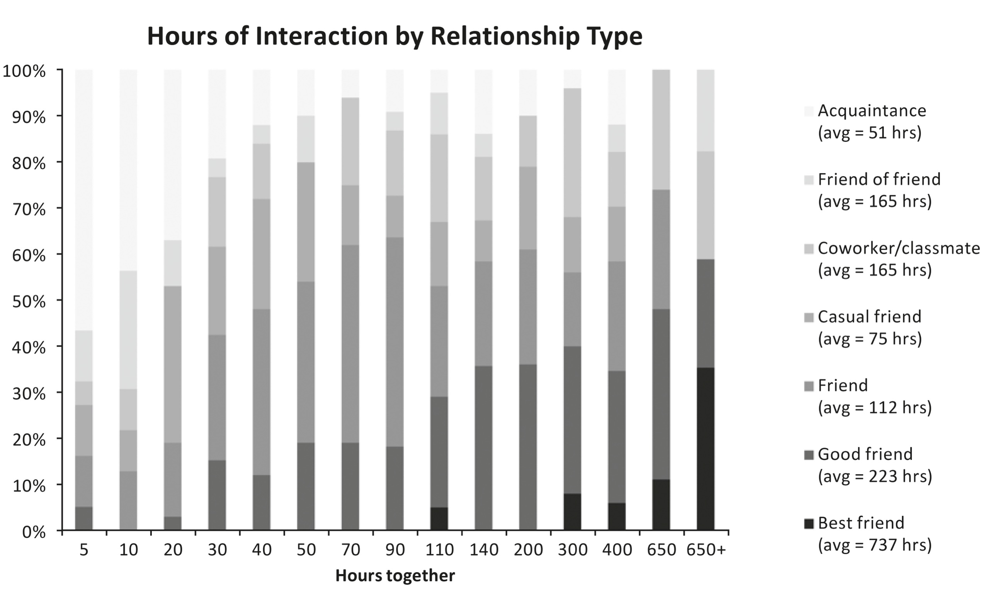

# Appendix: Image Description

The following image in this ebook illustrates complex ideas or contains a passage of text. Here it has been reproduced as a thumbnail and accompanied by an extended description.

* * *

The chart is titled “Hours of Interaction by Relationship Type.”

The image is a stacked bar chart titled “Hours of Interaction by Relationship Type.” It presents multiple vertical bars, each representing a range of “Hours together,” and shows what percentage of relationships at each time range fall into different categories (acquaintance, friend of friend, coworker/classmate, casual friend, friend, good friend, best friend, each represented by a different shade of gray).

### Chart type and axes

The chart is a vertical stacked bar chart.

  * **Horizontal axis (x-axis):** labeled “Hours together.” The tick marks and category labels along the axis are: 5, 10, 20, 30, 40, 50, 70, 90, 110, 140, 200, 300, 400, 650, and 650+.

  * **Vertical axis (y-axis):** runs from 0% at the bottom to 100% at the top. It is labeled with percentages at 10% increments: 0%, 10%, 20%, 30%, 40%, 50%, 60%, 70%, 80%, 90%, and 100%. Each stacked bar reaches 100%.

### Legend and relationship categories

On the right side of the chart, a legend lists the relationship types and their average hours of interaction. Each relationship type is associated with a distinct shading pattern in the stacked bars. The legend text reads:

  * “Acquaintance (avg = 51 hrs)”

  * “Friend of friend (avg = 165 hrs)”

  * “Coworker/classmate (avg = 165 hrs)”

  * “Casual friend (avg = 75 hrs)”

  * “Friend (avg = 112 hrs)”

  * “Good friend (avg = 223 hrs)”

  * “Best friend (avg = 737 hrs)”

Each category appears as a horizontal sample block in the legend, matching the shading used in the stacked bars.

### Patterns across hours together

#### Early hours: 5 to 20 hours

  * At 5 hours together, the bar is dominated by acquaintance relationships. A small portion at the bottom represents early-stage friendships (friend or casual friend), and there is a very small segment for good friends or best friends, indicating that a small minority of relationships reach deeper levels even within 5 hours.

  * At 10 hours, acquaintances still occupy most of the bar, but the segments for casual friends and friends are slightly larger than at 5 hours. There is still only a small presence of good friends and best friends.

  * At 20 hours, acquaintances remain the largest category, but the share of casual friends and friends has grown. The presence of good friends is more noticeable, and best friends remain a very small fraction.

#### Intermediate hours: 30 to 90 hours

  * At 30 hours, the acquaintance segment shrinks compared with earlier bars. Casual friends and friends occupy a larger portion of the bar, and good friends are more visible. Best friends are still a small segment at the bottom.

  * At 40 and 50 hours, acquaintances continue to decline as a proportion of relationships. Casual friends and friends make up a substantial share of the bar, and good friends occupy a moderate portion. Best friends remain a small but growing segment.

  * At 70 and 90 hours, acquaintances and friend-of-friend relationships occupy less of the bar than at lower hours. Coworker/classmate and casual friend segments are present but not dominant. The friend and good friend segments are larger, indicating that more relationships have progressed to closer friendship. Best friends are still a minority but more visible than at lower hours.

#### Later hours: 110 to 200 hours

  * At 110 hours, acquaintance and friend-of-friend segments are relatively small. Coworker/classmate and casual friend segments are moderate. The friend and good friend segments occupy a substantial portion of the bar, and best friends are present as a small but noticeable segment.

  * At 140 hours, the distribution continues to shift toward closer relationships. The acquaintance segment is small, and friend-of-friend and coworker/classmate segments are moderate. Casual friend, friend, and good friend segments together make up much of the bar, with best friends occupying a small portion at the bottom.

  * At 200 hours, acquaintances are minimal. Friend-of-friend and coworker/classmate segments are present but smaller than at lower hours. Casual friend and friend segments are substantial, and good friends occupy a significant portion. Best friends are still a minority but larger than at earlier time ranges.

#### High hours: 300 to 650+ hours

  * At 300 hours, acquaintance relationships are very small. Friend-of-friend and coworker/classmate segments are modest. Casual friend and friend segments are present but not dominant. Good friends occupy a large portion of the bar, and best friends form a noticeable segment at the bottom, indicating that a meaningful share of relationships have become best friendships by this point.

  * At 400 hours, acquaintances are nearly absent. Friend-of-friend and coworker/classmate segments are small. Casual friend and friend segments are moderate. Good friends occupy a large portion of the bar, and best friends form a larger segment than at 300 hours.

  * At 650 hours, acquaintances and friend-of-friend relationships are minimal. Coworker/classmate and casual friend segments are small. Friend and good friend segments are present but not dominant. Best friends occupy a substantial portion of the bar, indicating that many relationships with this amount of time together are best friendships.

  * At 650+ hours, the bar shows the highest proportion of best friends. Acquaintances and friend-of-friend relationships are nearly absent. Coworker/classmate and casual friend segments are small. Friend and good friend segments are moderate, and best friends occupy a large share of the bar, reflecting that very high hours of interaction are strongly associated with best-friend relationships.

[Back to image in Chapter 2: Fast Friends (The Art of Accelerating Attachment).](010_c002_Chapter_2_Fast_Frien.xhtml#image_page_42)
